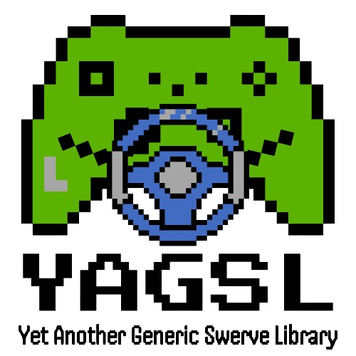

# Welcome to YAGSL

<figure><figcaption></figcaption></figure>

YAGSL is a swerve library developed by current and former BroncBotz mentors for all FRC teams. It reads a JSON description of your swerve drive and builds a [YAMS](https://yams.yamgen.com/) `SwerveDrive` from it: describe your hardware once at [**config.yagsl.com**](https://config.yagsl.com), and drive. See [What is YAGSL?](how-it-works/what-is-yagsl.md) for how the pieces fit together.


YAGSL 2027 is built on WPILib 2027 (`2027_alpha7`, Java 25) and runs on the SystemCore. It supports both WPILib Commands v2 and Commands v3, each with its own vendordep. See the [Changelog](upgrading/changelog.md) for what changed in the 2027 port.


## Where to start

| If you...                                        | Go to                                                                                                                     |
| ------------------------------------------------ | ------------------------------------------------------------------------------------------------------------------------- |
| are setting up YAGSL for the first time          | [**Your first swerve robot**](get-started/tutorial.md), seven steps from a bare WPILib project to a driving robot         |
| have a robot that isn't driving right            | [**Find your problem**](fix-a-problem/fix-a-problem.md), which matches what your robot is doing to the page that fixes it |
| have a driving robot and want to do more with it | [**Tune and extend**](tune-and-extend/how-to.md): PIDF tuning, drive to a pose, PathPlanner and more                      |
| are upgrading a 2026 project                     | [**Upgrade a 2026 project to YAGSL 2027**](upgrading/upgrade-from-2026.md), before you do anything else                   |
| need an exact JSON field, device type or API     | [**Reference**](reference/reference.md)                                                                                   |



## Install

Install **exactly one** YAGSL vendordep, matching the WPILib command framework your robot uses (they conflict with each other). In WPILib's VS Code, open the **WPILib Vendor Dependencies** panel and install **Yet Another Generic Swerve Library (Commands v2)** or **(Commands v3)**.

[Install YAGSL](get-started/02-install-yagsl.md) covers the YAMS vendordep each one requires, installing from a URL instead, updating to beta versions, and the vendor libraries for your hardware.


The old `https://yet-another-software-suite.github.io/YAGSL/...` vendordep and maven URLs are stale. Remove the old `yagsl.json` from your `vendordeps` folder and install YAGSL again.




## Our philosophy

Your program does not revolve around your swerve drive. Your constants file doesn't have to take 10 minutes to find the right option. Different robots should be able to work with the same code: swap the `swerve/` config directory and the same subsystem code drives a different robot.
