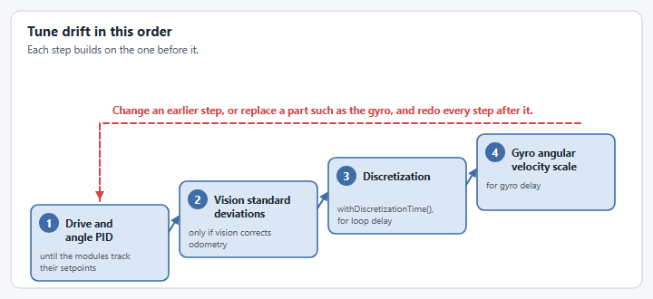

# Fix swerve drive drift

Swerve drive drift has been a persistent problem for many years, and there have been many discussions as to why it happens. This is a lookup of common causes, followed by the fixed tuning order that removes what's left. For step-by-step tuning instructions, see [How to Tune PIDF Gains](../tune-and-extend/tune-pidf-gains.md).

It's important to keep in mind that SEVERAL of these issues could be present on your robot at once.

Prefer to work through it step by step? See [Troubleshooting](troubleshooting.md), and the [Robot is drifting](troubleshooting.md#robot-is-drifting) checks.

## Hardware causes

### Wiring

Incorrect, worn, or loose wiring produces different symptoms depending on which connector is affected.

**Encoder**

* [ ] Telemetry readings are erratic and nonsensical.
* [ ] Motor could spin out of control.
* [ ] Errors appear in the Driver Station console.

**Motor controller**

* [ ] Telemetry may be slow to update.
* [ ] Motors may suddenly stop or spin out of control.
* [ ] Motors may not respond to commands.
* [ ] Errors appear in the Driver Station console.

**Gyroscope**

* [ ] Telemetry may be slow to update.
* [ ] Field-relative robot control may be unusable.
* [ ] Autonomous drifts uncontrollably.
* [ ] Errors appear in the Driver Station console.
* [ ] The gyro is moving/shaking violently, or shifted during movement.

### Physical components

**Magnetic (absolute) encoder**

* [ ] The encoder is too far from the magnet to read it reliably. The vendor's documentation says how to tell, usually from a status light or a magnet strength reading.
* [ ] Magnet is not secured to the swerve module and slips while in motion; absolute encoder offsets would need constant readjustment until the magnet is secured (loctite/glue it in).
* [ ] Magnetic encoder itself is not secured to the module.

**Motor**

* [ ] Motor doesn't have a firm connection to the module shaft; it will "twitch" while running if a current limit is set.
* [ ] Motor is dying; it needs more stator current to move than the same motor on the other modules. Graph `Mechanisms/swerve/modules/<name>/azimuth/current/stator` (or `drive/current/stator`) for every module and compare.

**Swerve module**

* [ ] Wheels are misaligned.
* [ ] Modules behave inconsistently with the same PID gains; grease may need to be applied to the gears.

**Robot**

* [ ] Robot center of gravity is not ideal.

## Software causes

* [ ] Constant `Command Scheduler loop overruns` because of other parts of your code. Overruns just after the code starts are normal, and on the SystemCore overruns may no longer cause drift.
* [ ] Maximum physical velocity isn't set correctly. See `SwerveDriveConfig.withMaximumChassisSpeed()`/`withMaximumModuleSpeed()`.
* [ ] If using open-loop control, modules run at different speeds.
* [ ] Controller input filtering.
* [ ] Discretization not compensating for system delay. See `SwerveDriveConfig.withDiscretizationTime()`.
* [ ] Vision measurement standard deviations aren't tuned. See `SwerveDrive.addVisionMeasurement()`/`setVisionMeasurementStdDevs()`.
* [ ] Heading drifted. See `SwerveDrive.zeroGyro()` / `zeroOdometryHeading()` and `resetOdometry(Pose2d)`.


Several runtime tuning knobs from older YAGSL versions (`setCosineCompensator`, `setHeadingCorrection`, `setAntiJitter`, `chassisVelocityCorrection`, `setMaximumSpeeds`, `replaceSwerveModuleFeedforward`, `setOdometryPeriod`, `updateCacheValidityPeriods`) no longer exist as runtime methods on `SwerveDrive`. Cosine compensation is now always enabled internally by the parser, and the rest are configured once, up front, via `SwerveDriveConfig`/`SwerveModuleConfig` (or `pidfproperties.json`'s `s`/`v`/`a` feedforward terms) rather than toggled at runtime. See the [API reference](../reference/api-reference.md) and [schema changes reference](../upgrading/schema-changes.md) for what replaced each.


### PathPlanner

* [ ] PathPlanner `AutoBuilder` PIDs aren't tuned well.
* [ ] Maximum module velocity is too high or too low.
* [ ] Test path is curved instead of straight.
* [ ] PathPlanner auto doesn't define a preset starting pose.
* [ ] PathPlanner path doesn't reset odometry on start.

## Configuration causes

* [ ] Module locations aren't defined correctly. Remember these are measured from the center of the robot to the center of the module. See [how to verify module locations](verify-module-locations.md).
* [ ] Swerve module JSON doesn't have the correct device definitions for the absolute encoder, angle motor, or drive motor.
* [ ] A module's `gearing` override in its module JSON disagrees with the default in `physicalproperties.json`.
  * A per-module `gearing` override is completely **OPTIONAL** and shouldn't be defined unless you have a specific reason (e.g. one swapped module with a different ratio); otherwise rely on `physicalproperties.json` to avoid drift between modules.
* [ ] The gear ratio/wheel diameter is not correct.
  * If your swerve drive consistently travels further than expected with PathPlanner, this is a likely cause.
  * If your angle motors never align the module correctly, this can also cause it.
* [ ] Drive and steering/azimuth/angle motor PIDs aren't tuned well enough. See [how to tune PIDF gains](../tune-and-extend/tune-pidf-gains.md).
* [ ] The current limit (`statorCurrentLimit`) is too low.
* [ ] [Translational axis changes with robot orientation](the-8-steps.md).

## Tuning order

Once hardware and configuration issues are ruled out, tune in this order. Each step builds on the last, so redoing an earlier one (or replacing hardware like your gyro) means redoing everything after it:

<figure><figcaption>
The order to tune drift in.
</figcaption></figure>

1. **Drive and angle PID**: see [how to tune PIDF gains](../tune-and-extend/tune-pidf-gains.md). Do this first; nothing else is worth tuning until the modules track their setpoints well.
2. **Vision standard deviation**, if you're using vision to help odometry: tune `SwerveDrive.setVisionMeasurementStdDevs()` mostly by guess-and-check, scaling with distance. Some teams get better stability by filtering out vision poses beyond a certain distance.
3. **Discretization**, to compensate for system delay: `SwerveDriveConfig.withDiscretizationTime()`. See [chassis control](../how-it-works/chassis-control.md) for what this does and why it matters.
4. **Gyro angular velocity scale factor**, to compensate for gyro system delay: `SwerveDriveConfig.withGyroAngularVelocityScaleFactor()` (less necessary with a Pigeon 2 on a CANivore, which has very low latency).


If you mess with a lower step, all the higher steps will be out of sync, and if you replace a part like your gyro, you may need to redo all of it anyway.


The math-heavy explanation of tuning out drift is available here:


