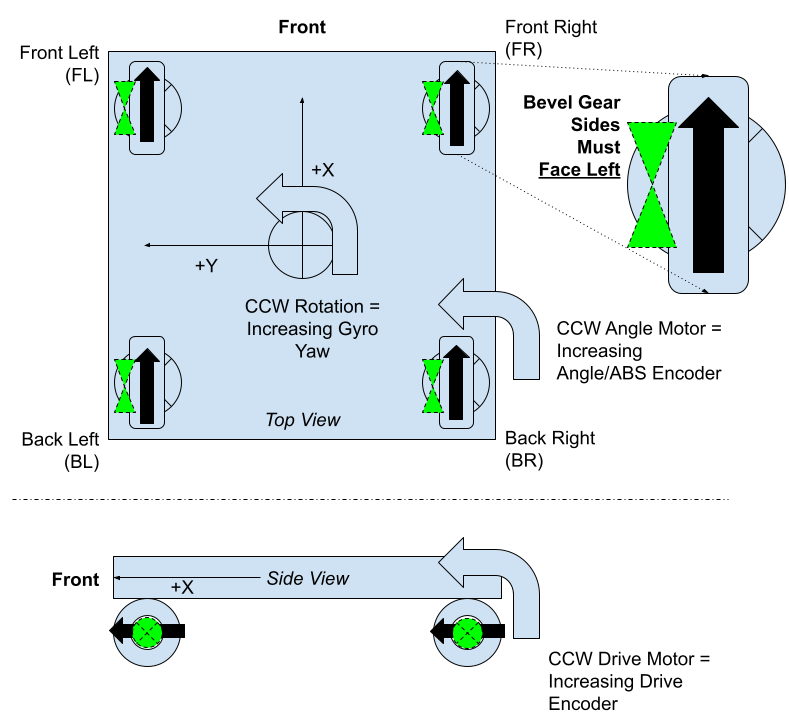

# Troubleshooting

Most swerve problems come from something basic, so check the basics first. This page checks a swerve drive in stages, from the robot itself up to autonomous. Start at stage 1, and only move on when a stage passes. If a stage finds a problem, fix it, then start that stage again.

Within each stage, do the fast checks first, such as reading a graph, and the slow ones last, such as measuring the robot.

* Know your symptom? [By symptom](troubleshooting.md#by-symptom) lists the checks most likely to catch it, but still work through the stages in order.
* Setting up a new robot? The config generator's [Quick Start Guide](https://config.yagsl.com/guide) walks the same checks as you go.
* Not sure what's wrong? [Find your problem](fix-a-problem.md) matches symptoms to pages.

## Swerve drive diagram

<figure><figcaption></figcaption></figure>


Gyroscopes drift. They're sensitive to pressure, and sometimes humidity, and older ones like the Pigeon 1 and NavX 1 drift the longer they're powered on. If yours drifts, recalibrate it, and zero it at the start of your program.


## The stages

Each stage has a section below, with links to the pages that help with it.

1. [Is it built right?](troubleshooting.md#stage-1-is-it-built-right)
2. [Do the sensors and motors work?](troubleshooting.md#stage-2-do-the-sensors-and-motors-work)
3. [Is the configuration right?](troubleshooting.md#stage-3-is-the-configuration-right)
4. [Are the module locations right?](troubleshooting.md#stage-4-are-the-module-locations-right)
5. [Are the inversions and offsets right?](troubleshooting.md#stage-5-are-the-inversions-and-offsets-right)
6. [Are the gear ratios and wheel size right?](troubleshooting.md#stage-6-are-the-gear-ratios-and-wheel-size-right)
7. [Does the code drive it right?](troubleshooting.md#stage-7-does-the-code-drive-it-right)
8. [Are the PID, feedforward and current limits right?](troubleshooting.md#stage-8-are-the-pid-feedforward-and-current-limits-right)
9. [Is the code right for odometry and autonomous?](troubleshooting.md#stage-9-is-the-code-right-for-odometry-and-autonomous)

## Stage 1: Is it built right?

Check the robot itself before anything electrical or in code. Most of these need nothing but your hands and a tape measure.

* Wiring, magnets, the gyro and worn parts: [Fix swerve drive drift](swerve-drift-causes.md#hardware-causes)
* Wheel diameters: [Standard Conversion Factors](../reference/standard-conversion-factors.md)

## Stage 2: Do the sensors and motors work?

With the code running, check every sensor reads, and every motor moves without straining.

* Errors at startup: [Find your problem](fix-a-problem.md#the-robot-program-wont-start-or-a-device-does-nothing)
* What the magnet status light or reading means: your encoder's page under [Absolute Encoders](../reference/hardware/absolute-encoders.md), and the vendor's documentation
* Gyros: [Gyroscopes](../reference/hardware/gyroscopes.md)
* Graphing telemetry: [Set up AdvantageScope](../tune-and-extend/set-up-advantagescope.md)

## Stage 3: Is the configuration right?

Check the config files describe the robot you built: CAN IDs, buses, device types and module order.

* Generating the config: [Generate your configuration](../get-started/03-generate-your-configuration.md)
* Device type strings: [Device Type Strings](../reference/json-schema/device-types.md)
* CAN buses: [Put devices on a different CAN bus](../tune-and-extend/choose-a-can-bus.md)
* SPARK problems: [Fix common SparkMAX/SparkFlex problems](fix-sparkmax-common-problems.md)

## Stage 4: Are the module locations right?

Check where the code thinks each module is.

* Locations and which side is front: [Verify your module locations](verify-module-locations.md)

## Stage 5: Are the inversions and offsets right?

Check every sensor and motor counts the right way, and the absolute encoder offsets.

* Every inversion and the spin test: [Determine inversion](determine-inversion.md)
* Recording offsets: [Check and calibrate your hardware](../get-started/04-verify-and-calibrate-hardware.md)

## Stage 6: Are the gear ratios and wheel size right?

Check the numbers that turn motor rotations into angles and meters.

* Gear ratios, wheel diameters and inversions per module: [Standard Conversion Factors](../reference/standard-conversion-factors.md)
* Gearing overrides: [Module JSON](../reference/json-schema/module-json.md)

## Stage 7: Does the code drive it right?

Check the code passes the driver's sticks to the drive the way you mean it to.

* The drive code and gyro zeroing: [Write the swerve code](../get-started/write-the-swerve-code.md)
* Scaling and the maximum speed: [Chassis Control](../how-it-works/chassis-control.md#max-speed)
* Wrong at some headings: [Forward is not forward: the 8 steps](troubleshooting.md#forward-is-not-forward-the-8-steps)

## Stage 8: Are the PID, feedforward and current limits right?

Check each module reaches what it's told, in simulation and on the robot.

* Starting gains: [Tune PIDF gains](../tune-and-extend/tune-pidf-gains.md#starting-points)
* Tuning step by step: [Practice in simulation](../get-started/practice-in-simulation.md)
* Reading a DataLog: [View your DataLog in AdvantageScope](../tune-and-extend/view-your-datalog-in-advantagescope.md)
* Current limits: [physicalproperties.json](../reference/json-schema/physicalproperties-json.md)

## Stage 9: Is the code right for odometry and autonomous?

Check the code that tracks where the robot is and follows paths.

* Discretization, vision and everything else: [Fix swerve drive drift](swerve-drift-causes.md#tuning-order)
* Autos: [Set up PathPlanner](../tune-and-extend/setup-pathplanner.md)

## Forward is not forward: the 8 steps

Stage 7 sends you here when field-relative driving goes the wrong way at some headings.

When forward in real life isn't forward in odometry, or field-relative driving changes as the robot turns, the 8 steps try every combination of gyro inversion, drive inversion and module order that can cause it. Somewhere along the way it gets fixed. [The 8 steps](the-8-steps.md) has the drive code to test with, and how to flip the modules.

Test in field-relative driving. In robot-relative driving the direction is supposed to change as the robot turns, so it can't show this problem.


Most of the steps make the robot spin out of control. Keep it somewhere safe and be ready to disable it.


## By symptom

Work through the stages in order. These are the checks most likely to catch each symptom, so you know what to watch for.

### Set up a robot with the config guide

The [Quick Start Guide](https://config.yagsl.com/guide) takes a robot from a downloaded config to driving. Its steps line up with the stages:

* Set up the project, with your team number and config in `src/main/deploy/swerve`: [stage 3](troubleshooting.md#stage-3-is-the-configuration-right).
* Connect to the simulator and tune in simulation, until current follows desired: [stage 8](troubleshooting.md#stage-8-are-the-pid-feedforward-and-current-limits-right).
* Enter each module's location: [stage 4](troubleshooting.md#stage-4-are-the-module-locations-right).
* Align the modules and record each offset, and check every absolute encoder reads counterclockwise positive: [stage 5](troubleshooting.md#stage-5-are-the-inversions-and-offsets-right).
* Tune the real robot, check the gyro and spin each module 5 turns: [stage 5](troubleshooting.md#stage-5-are-the-inversions-and-offsets-right), [stage 6](troubleshooting.md#stage-6-are-the-gear-ratios-and-wheel-size-right) and [stage 8](troubleshooting.md#stage-8-are-the-pid-feedforward-and-current-limits-right).
* Hold the right stick left and check the robot spins counterclockwise: [stage 5](troubleshooting.md#stage-5-are-the-inversions-and-offsets-right).
* Drive each direction at 0°, 45° and 125° headings: [stage 7](troubleshooting.md#stage-7-does-the-code-drive-it-right).
* Maintenance, such as greasing the modules and re-measuring the wheels: [stage 1](troubleshooting.md#stage-1-is-it-built-right).

### Robot drives slower than it should

* A module running backwards in the spin test: [stage 5](troubleshooting.md#stage-5-are-the-inversions-and-offsets-right).
* A gear ratio or wheel diameter that's off, so the robot thinks it's faster than it is: [stage 6](troubleshooting.md#stage-6-are-the-gear-ratios-and-wheel-size-right).
* Scaling in the drive code, or a maximum speed set too low: [stage 7](troubleshooting.md#stage-7-does-the-code-drive-it-right).
* Untuned drive gains, or a drive current limit set too low: [stage 8](troubleshooting.md#stage-8-are-the-pid-feedforward-and-current-limits-right).
* The wrong drive pinion, a weak battery, or a SystemCore that's nearly out of storage: [stage 1](troubleshooting.md#stage-1-is-it-built-right).

### Autonomous is consistently off

It ends short or long by about the same amount every time.

* Worn tread, or the wrong drive pinion, such as 12T where you configured 14T: [stage 1](troubleshooting.md#stage-1-is-it-built-right).
* The drive gear ratio, wheel diameter or a per-module gearing override, and whether odometry matches a measured distance: [stage 6](troubleshooting.md#stage-6-are-the-gear-ratios-and-wheel-size-right).
* The path following, the starting pose and wheel slip: [stage 9](troubleshooting.md#stage-9-is-the-code-right-for-odometry-and-autonomous).

### Robot is drifting

* **Slides off its line** (translational drift): the absolute encoder offsets ([stage 5](troubleshooting.md#stage-5-are-the-inversions-and-offsets-right)), the angle gear ratio ([stage 6](troubleshooting.md#stage-6-are-the-gear-ratios-and-wheel-size-right)), field-relative driving at every heading ([stage 7](troubleshooting.md#stage-7-does-the-code-drive-it-right)), and whether each module reaches its angle ([stage 8](troubleshooting.md#stage-8-are-the-pid-feedforward-and-current-limits-right)).
* **Heading turns on its own** (rotational drift): a dying drive motor or a drifting gyro ([stage 2](troubleshooting.md#stage-2-do-the-sensors-and-motors-work)), the offsets ([stage 5](troubleshooting.md#stage-5-are-the-inversions-and-offsets-right)), wheel sizes and gearing overrides ([stage 1](troubleshooting.md#stage-1-is-it-built-right) and [stage 6](troubleshooting.md#stage-6-are-the-gear-ratios-and-wheel-size-right)), and whether each module reaches its speed ([stage 8](troubleshooting.md#stage-8-are-the-pid-feedforward-and-current-limits-right)).
* **Only while driving and rotating at once**: discretization, which YAGSL normally handles ([stage 9](troubleshooting.md#stage-9-is-the-code-right-for-odometry-and-autonomous)).

### Wheels not pointing straight

The wheels don't all point straight when you drive straight.

* CAN IDs, device types and module order: [stage 3](troubleshooting.md#stage-3-is-the-configuration-right).
* The absolute encoder offsets: [stage 5](troubleshooting.md#stage-5-are-the-inversions-and-offsets-right).
* Module locations, in inches: [stage 4](troubleshooting.md#stage-4-are-the-module-locations-right).
* The azimuth gains, and an angle current limit too low to hold the modules while driving hard: [stage 8](troubleshooting.md#stage-8-are-the-pid-feedforward-and-current-limits-right).

### One module doesn't start in the right position

One module's azimuth acts up, or points somewhere different each time the robot starts.

* The module built incorrectly, or binding: [stage 1](troubleshooting.md#stage-1-is-it-built-right).
* A disconnected encoder, an encoder too far from its magnet, a slipping magnet, or a dying motor: [stage 2](troubleshooting.md#stage-2-do-the-sensors-and-motors-work).
* The angle gear ratio: [stage 6](troubleshooting.md#stage-6-are-the-gear-ratios-and-wheel-size-right).

### Swerve modules spinning "out of control"

* Loose sensor cables: [stage 1](troubleshooting.md#stage-1-is-it-built-right).
* The absolute encoder and angle motor readings increasing when you turn the module counterclockwise: [stage 5](troubleshooting.md#stage-5-are-the-inversions-and-offsets-right).
* The conversion factors, checked against Standard Conversion Factors: [stage 6](troubleshooting.md#stage-6-are-the-gear-ratios-and-wheel-size-right).
* The PID gains: [stage 8](troubleshooting.md#stage-8-are-the-pid-feedforward-and-current-limits-right).

### Swerve module does not spin correctly

* The magnet glued in: [stage 1](troubleshooting.md#stage-1-is-it-built-right).
* A good reading on the magnet, usually a green status light: [stage 2](troubleshooting.md#stage-2-do-the-sensors-and-motors-work).
* CAN IDs, motor types and absolute encoder types: [stage 3](troubleshooting.md#stage-3-is-the-configuration-right).
* The offsets, recorded with the bevel gear facing left and the wheel pointing straight, and the inversions: [stage 5](troubleshooting.md#stage-5-are-the-inversions-and-offsets-right).
* Module locations: [stage 4](troubleshooting.md#stage-4-are-the-module-locations-right).
* The PID gains: [stage 8](troubleshooting.md#stage-8-are-the-pid-feedforward-and-current-limits-right).

### Swerve drive "spins out of control"

* The gyro reading increasing when the robot turns counterclockwise, the offsets and the inversions: [stage 5](troubleshooting.md#stage-5-are-the-inversions-and-offsets-right).
* Module locations, in inches from the robot's center: [stage 4](troubleshooting.md#stage-4-are-the-module-locations-right).
* The controller input, checked against the desired states in the Swerve tab: [stage 7](troubleshooting.md#stage-7-does-the-code-drive-it-right).
