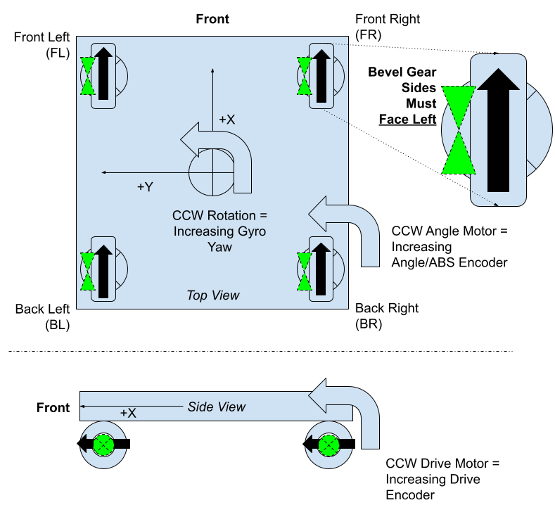
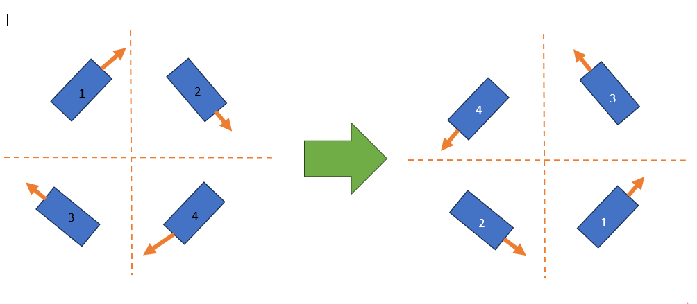

# Verify your module locations

After you have initially configured the robot with YAGSL, test it on blocks to make sure the modules are facing the correct directions while in the air. You may need to [swap the module configurations](the-8-steps.md#how-to-swap-module-configurations) around to ensure they're doing what the robot program thinks they're doing.

## Drive straight

The first test is to command the robot to drive straight. The modules should look like this both in real life and in Elastic or [AdvantageScope](../tune-and-extend/set-up-advantagescope.md).

<figure><figcaption></figcaption></figure>

If it doesn't look like this in real life, change the offending modules' `location` (and, if needed, CAN IDs) to match this layout.

## Rotate the robot

Your robot should rotate CCW+. For this verification step, as long as the robot appears to be doing either of the following while attempting to rotate, you should be fine.


The depiction on the left requires you to run through [The 8 steps](the-8-steps.md), since your translational axis changes based on your robot's heading.


<figure><figcaption></figcaption></figure>
