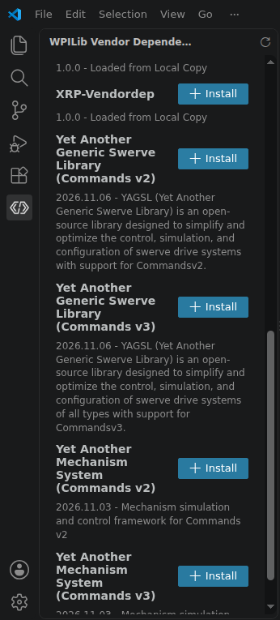
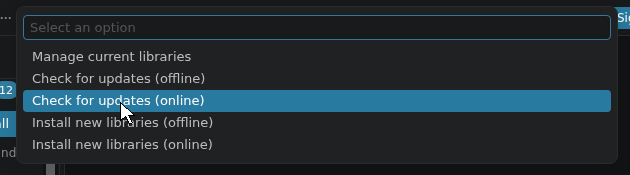

# 3. Install YAGSL

YAGSL 2027 is built on WPILib 2027 (`2027_alpha7`) and Java 25, and runs on the SystemCore. Install the matching WPILib release first, then create or open your robot project.

## Add the YAGSL vendordep

YAGSL ships as two vendordeps, one per WPILib command framework. Install **exactly one** of them, the one that matches the command framework your robot project uses. They conflict with each other, so do not install both.

In WPILib's VS Code, click the **WPILib Vendor Dependencies** icon in the sidebar. Under **Available Dependencies**, find **Yet Another Generic Swerve Library** for your command framework, **(Commands v2)** or **(Commands v3)**, and click **Install**.

<figure><figcaption><p>YAGSL in the WPILib Vendor Dependencies panel.</p></figcaption></figure>

YAGSL builds a [YAMS](https://yams.yamgen.com/) `SwerveDrive`, so it requires the matching YAMS vendordep, **Yet Another Mechanism System**. It's installed along with YAGSL. If it isn't, install it from the same panel, for the same command framework. YAMS in turn requires the matching WPILib command framework vendordep (Commands v2 or Commands v3).


Not sure which one to pick? Use Commands v2 if your project uses `SubsystemBase` and PathPlanner. Use Commands v3 if your project uses `Mechanism`s, coroutines and the OpMode framework. The rest of this tutorial shows both where they differ.


### Alternative: install from a URL

If YAGSL isn't listed in the panel, open **Install from URL** at the top of the panel, or run **WPILib: Manage Vendor Libraries → Install new libraries (online)**, and paste the URLs for your command framework:

| Command framework | YAGSL                                               | YAMS                                               |
| ----------------- | --------------------------------------------------- | -------------------------------------------------- |
| Commands v2       | `https://cdn.yassrobotics.com/yagsl_commands2.json` | `https://cdn.yassrobotics.com/yams_commands2.json` |
| Commands v3       | `https://cdn.yassrobotics.com/yagsl_commands3.json` | `https://cdn.yassrobotics.com/yams_commands3.json` |


Upgrading an older project? The old `https://yet-another-software-suite.github.io/YAGSL/...` vendordep and maven URLs are stale. Delete the old `yagsl.json` (and the old `yams.json`) from your project's `vendordeps` folder, then install YAGSL again from the panel.


## How to update to beta versions

The Vendor Dependencies panel installs the version WPILib has listed, which can lag behind the newest YAGSL and YAMS releases. To get the newest, beta versions included:

1. Open the command palette with **Ctrl+Shift+P**, and run **WPILib: Manage Vendor Libraries**.
2. Click **Check for updates (online)**.
3. Check YAGSL and YAMS, and click **OK**.

<figure><figcaption><p>Updating YAGSL and YAMS with Check for updates (online).</p></figcaption></figure>

## Add vendordeps for your hardware (optional)

YAGSL does not require any hardware vendor library. It only loads a vendor's classes when your JSON configuration uses one of that vendor's devices, so install a vendordep for the hardware your robot actually has and skip the rest:

| Vendor         | Needed for                                                                 |
| -------------- | -------------------------------------------------------------------------- |
| CTRE Phoenix 6 | TalonFX, TalonFXS, Pigeon 2.0, CANcoder                                    |
| REVLib         | SparkMAX, SparkFlex, REV spline encoder                                    |
| ReduxLib       | Canandgyro, Canandmag                                                      |
| ThriftyLib     | Thrifty Nova                                                               |
| StudicaLib     | NavX3, over CAN or USB                                                     |
| None           | SystemCore IMU, and encoders wired to the SystemCore's DIO or analog ports |

Use the 2027 build of each vendor library. If your configuration names a device whose vendor library is not installed, the project still builds, but the robot program fails at startup when `SwerveParser` tries to create that device.


The AndyMark library has not published a `2027_alpha7` vendordep yet. Until it does, the `andymarkhexbore_can` encoder cannot be used with YAGSL 2027. Wire the encoder to a SmartIO port or the angle motor controller instead.


[Vendordeps and offline install](../reference/vendordep-installation.md#optional-vendor-libraries) lists which vendor library each device type string needs.


Install these from the Vendor Dependencies panel too. If a vendor isn't listed there yet on your WPILib version, install it from a URL instead. [Installing 3rd-party libraries](https://docs.wpilib.org/en/2027/docs/software/vscode-overview/3rd-party-libraries.html) covers pasting a URL, which you can get from the vendor's own install page.



Your vendor's hardware client (REV Hardware Client, Phoenix Tuner X) is a separate tool from the vendordep. Install it too, it's needed for firmware updates and low-level device configuration.


## No internet at the robot?

If your network blocks the download, install YAGSL and YAMS from their offline zips instead. See [Offline install](../reference/vendordep-installation.md#offline).

## Add your configuration

Create the folder `src/main/deploy/swerve/base` in your project and extract the contents of the `swerve-config.zip` you downloaded in [step 2](03-generate-your-configuration.md) into it, so the layout looks like this:

```
src/main/deploy
└── swerve
    └── base
        ├── swervedrive.json
        └── modules
            ├── frontleft.json
            ├── frontright.json
            ├── backleft.json
            ├── backright.json
            ├── physicalproperties.json
            ├── pidfproperties.json
            └── pidfproperties_sim.json
```

`pidfproperties_sim.json` starts as a copy of `pidfproperties.json`. YAGSL reads it in place of `pidfproperties.json` when the robot program runs in simulation, so you can tune simulation gains without touching the gains for your real robot.


The folder name is up to you, as long as it matches the path you hand to `SwerveParser.parse(...)` in [step 4](write-the-swerve-code.md). This tutorial uses `swerve/base` throughout.


Commit these files to your project's version control along with your code. They're part of your robot program, not a build artifact.

## Build

Run a Gradle build to pull down the libraries, and make sure it succeeds.
