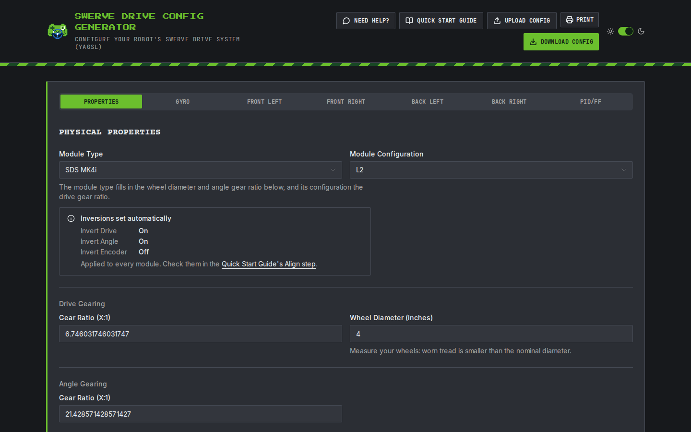

# 2. Generate your configuration

Since 2026, the supported way to configure YAGSL is [config.yagsl.com](https://config.yagsl.com), a web app that builds your configuration files from a guided form instead of you hand-writing JSON. It runs entirely in your browser, and it produces the same files for Commands v2 and Commands v3 projects.

<figure><figcaption>
The config generator. Picking a module type fills in its gear ratios, wheel diameter and inversions.
</figcaption></figure>

* **On a phone:** the whole generator works on a phone, so you can fill it in at the robot.
* **On paper:** **Print** prints every tab, with the dropdown options listed and a blank line for each value. Fill it in by hand, then type it in later.
* **Quick Start Guide:** **Download Config** opens the generator's Quick Start Guide, a printable checklist that takes you from the YAGSL example project, through tuning in simulation, to calibrating and tuning the real robot. It is the quickest way to spin up YAGSL; the rest of this tutorial explains the same steps in more depth.


Hand-editing the JSON files is still possible and fully supported. See the [JSON Schema Reference](../reference/json-schema/) if you need to script config generation or tweak a value the generator doesn't expose. Most teams should use the generator, though: it validates your inputs and always produces a schema-correct config.


## Fill in the form

The generator is organized into seven tabs. Work through them in order, using the information you collected in [step 1](01-gather-your-robot-information.md):

1. **Properties**: pick your **Module Type** and **Module Configuration** (for example SDS MK4i, L2). That fills in the drive and angle gear ratios and the wheel diameter, and sets each module's inversions for that module type. Measure your wheels: worn tread is smaller than the nominal diameter. Stator current limits for the drive and angle motors are optional.
2. **Gyro**: pick the **Connection** (CAN, USB, SystemCore for the IMU built into the SystemCore, or Custom to supply your own in code), then the gyro on it, which axis reports yaw, and whether it needs to be inverted. A CAN gyro also needs its CAN ID and CAN bus, and a NavX3 on USB needs the SystemCore USB port it's plugged into.
3. **Front Left**, **Front Right**, **Back Left**, **Back Right** (one tab each): for every module, set the drive motor type/ID, angle motor type/ID, absolute encoder type/ID (or channel, for an encoder on a SystemCore DIO or analog port), and the module's location relative to the robot center. The inversions start at the ones your module type set, and a module can override the gearing from the Properties tab. Thrifty Nova motor types (`nova_neo`, `nova_minion`, `nova_pulsar`, and so on) are in the motor list alongside TalonFX, TalonFXS, SparkMAX and SparkFlex.
4. **PID/FF**: starting PID and feedforward gains for the drive and angle motors.

### CAN bus fields

Every **CAN Bus** field takes the same values, whichever vendor made the device:

| CAN Bus value   | Bus                                                         |
| --------------- | ----------------------------------------------------------- |
| empty           | `can_s0`, the SystemCore's first CAN bus                    |
| `0` to `4`      | `can_s0` to `can_s4`, so `1` is `can_s1`                    |
| `5` to `24`     | The Motioncore buses `can_d0` to `can_d19`                  |
| a CANivore name | CTRE devices only (TalonFX, TalonFXS, CANcoder, Pigeon 2.0) |

The generator flags a bus number that does not exist, and a name on a device that only accepts a bus number (REV, Thrifty and Redux devices in the form).


CTRE devices with an empty CAN bus are on `can_s0`, like every other vendor. In YAGSL releases before `2026.10.09` they landed on Phoenix 6's own SystemCore default, `can_s2`. If your CTRE devices are wired to `can_s2`, enter `2`.


You can leave absolute encoder offsets and final PIDF gains at their defaults for now. You'll measure and tune those in later steps. The important thing at this stage is getting hardware types, IDs, CAN buses and module locations correct.

## Download

When you're done, click **Download Config**. You get `swerve-config.zip`, which has `swervedrive.json` and the `modules` folder at its top level. You'll add it to your robot project in the [next step](02-install-yagsl.md#add-your-configuration).


If you already have a config directory from a different robot, zip up its `swervedrive.json` and `modules` folder and use **Upload Config** to load it back into the generator to review or edit it, instead of starting from scratch. **Print** gives you a paper copy of the whole configuration for bring-up.

