# 6. Check and calibrate your hardware

Before your first drive, confirm every sensor and motor reports direction consistently and capture each module's absolute encoder offset. Skipping this step is the single most common cause of a swerve drive that "spins out" or drives in the wrong direction.

Work through the steps in order, with the robot on blocks.


The [config generator's Quick Start Guide](https://config.yagsl.com/guide) walks through this same process as interactive, printable checklists.




### Label every device and check the CAN IDs

Label each motor controller, encoder and the gyroscope with its type, CAN ID (or channel) and bus before you start. This is the easiest step to get wrong and the hardest mistake to spot afterward.

<figure>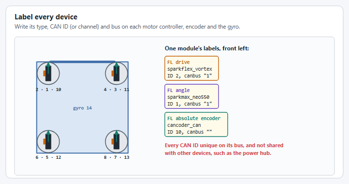<figcaption>
Label every device with its type, ID and bus.
</figcaption></figure>


Make sure every CAN ID is unique across your entire robot, and that each device's CAN bus in your config matches the SystemCore bus it is actually wired to (an empty `canbus` means `can_s0`). A known failure mode: if a SparkMAX shares a CAN ID with your REV Power Distribution Hub, the SparkMAX simply won't move, with no obvious error.




### Deploy, stay disabled, and open AdvantageScope

Deploy your code from [step 4](write-the-swerve-code.md) with the config from step 2 and **keep the robot disabled**. Open AdvantageScope's `Mechanisms/swerve` NetworkTables tree, where the swerve code publishes these values. The `swerve` in the path is the name that code passes to `SwerveDriveConfig.withTelemetry("swerve", ...)`.

<figure>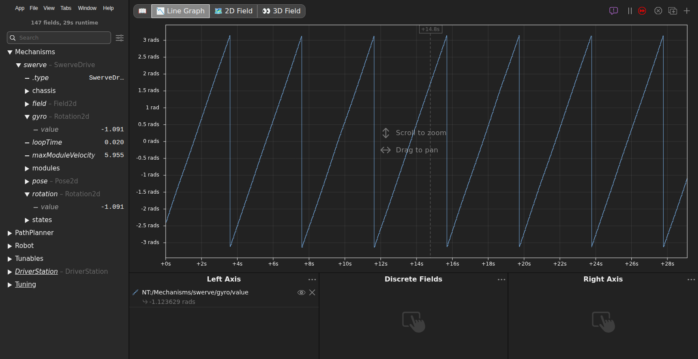<figcaption>
The Mechanisms/swerve tree in AdvantageScope. Each module's drive/azimuth telemetry and raw absolute encoder are visible per-module.
</figcaption></figure>


If you're using a hardware vendor client to poke at motors/encoders directly, your robot program must not be commanding those devices at the same time. Keep the robot disabled while you use the client, and power-cycle the robot when you're done so the SystemCore and your robot program start from a clean state.




### Pick a front and check the gyroscope

**Front is whatever the gyroscope reports as `0`.** Pick a front, and expect that you may need to change it later if it turns out to be inconvenient. Then lift the robot and turn it counterclockwise (seen from above): `Mechanisms/swerve/gyro` (the gyro's `Rotation2d`) must go **up**. If it goes down, set `gyroInvert` to `true` in `swervedrive.json`.

<figure>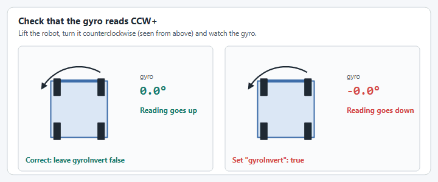<figcaption>
Turn the robot counterclockwise: the gyro should go up.
</figcaption></figure>

If you're using a NavX, recalibrate it once it arrives at your shop because NavX units ship calibrated to the humidity of their factory, not your build space. Recalibrate again periodically, especially at competition.



### Check each drive motor

Point the module forward, then roll its wheel forward by hand. That module's `modules/<name>/drive/measurement/position` (the distance the wheel has rolled, in meters) must go **up**. If it goes down, set `"inverted": { "drive": true }` in that module's JSON.

<figure>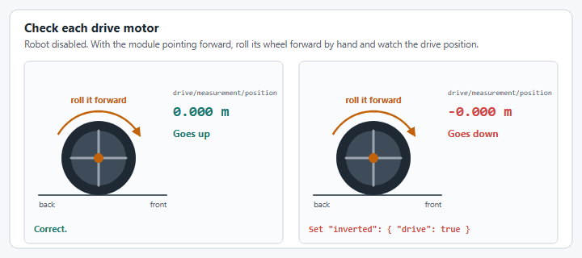<figcaption>
Roll the wheel forward: the drive position should go up.
</figcaption></figure>



### Check each angle motor and absolute encoder

Turn the module counterclockwise (seen from above) by hand. Both `modules/<name>/azimuth/mechanism/position` (relative, in rotations) and `modules/<name>/encoder` (absolute, in degrees) must go **up**.

* If the **encoder** goes down, set `"absoluteEncoderInverted": true`.
* If the **azimuth** position goes down, set `"inverted": { "angle": true }`.

<figure>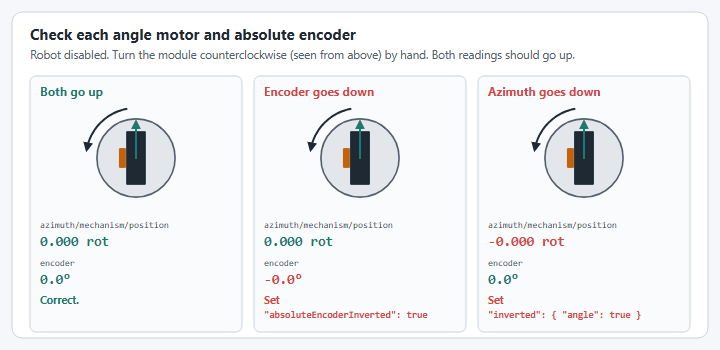<figcaption>
Turn the module counterclockwise: both readings should go up.
</figcaption></figure>

See [Determine Inversion](../fix-a-problem/determine-inversion.md) for the full decision procedure if any of these don't behave as expected.



### Align every wheel

Turn all four wheels by hand so they point forward, with their bevel gears facing the robot's left, and so rolling them forward makes the drive position go up.

<figure>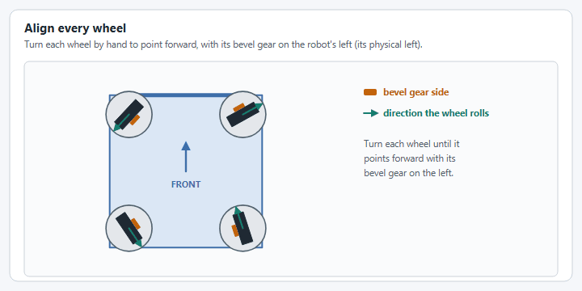<figcaption>
Every wheel forward, bevel gears on the left.
</figcaption></figure>

<figure>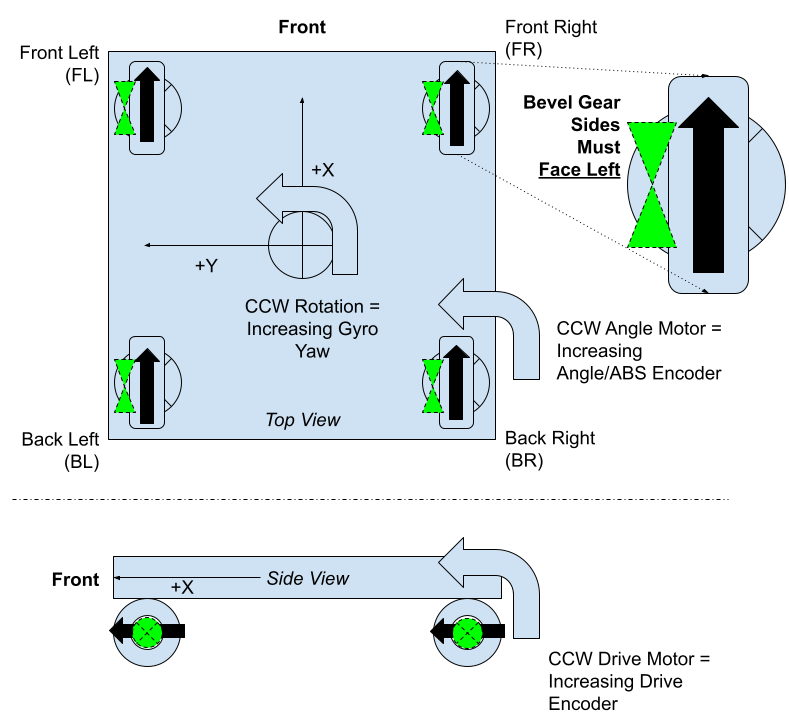<figcaption>
The left and right are physical left and right.
</figcaption></figure>



### Record each module's offset

With the wheels still aligned and the robot still disabled, read each module's `Mechanisms/swerve/modules/<name>/encoder` and enter it as that module's absolute encoder offset.

In AdvantageScope, connected to the robot as in [Set up AdvantageScope](../tune-and-extend/set-up-advantagescope.md), open **Mechanisms → swerve → modules** in the sidebar. Open each module in turn and read the number beside **encoder**. It's in degrees; hover over it to check.

<figure>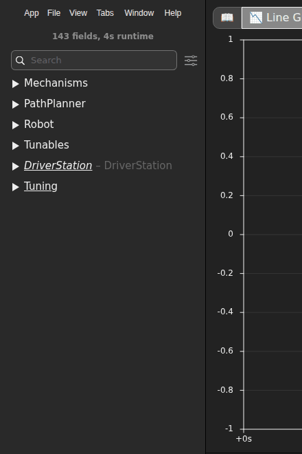<figcaption>
Reading each module's encoder in AdvantageScope.
</figcaption></figure>

<figure>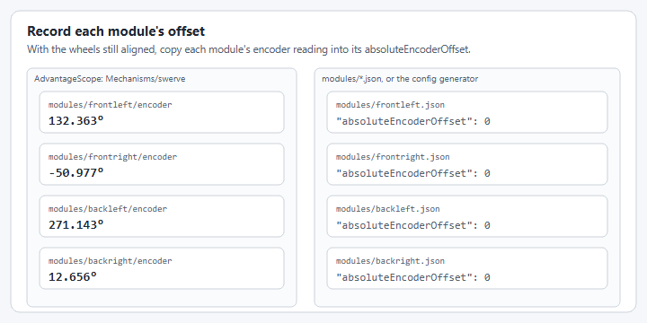<figcaption>
Each encoder reading becomes that module's offset.
</figcaption></figure>

The config generator walks you through it. Its Quick Start Guide's [Align Modules step](https://config.yagsl.com/guide#align) shows how to align the wheels and which reading to copy for each module.

<figure>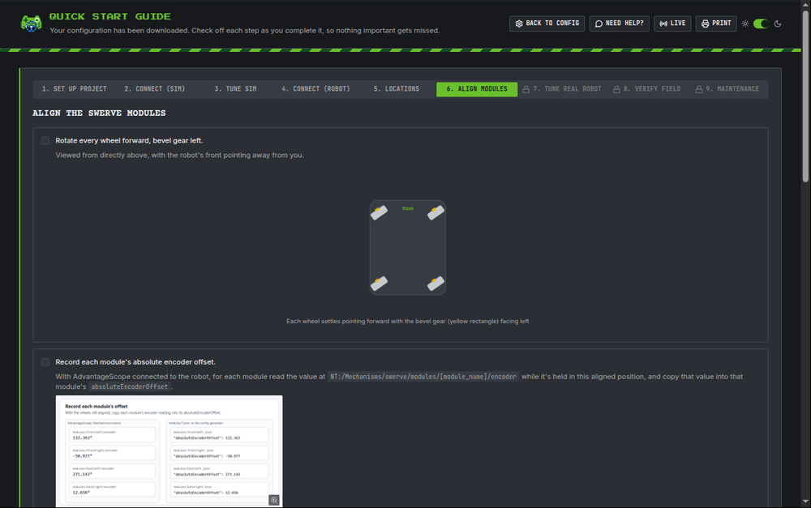<figcaption>
The Align Modules step of the config generator's Quick Start Guide.
</figcaption></figure>

Then, in the [config generator](https://config.yagsl.com), click **Upload Config** to load your configuration, enter each reading in that module's tab under **Offset (degrees)**, and click **Download Config**. You can also edit `absoluteEncoderOffset` in each module's JSON file directly.

<figure>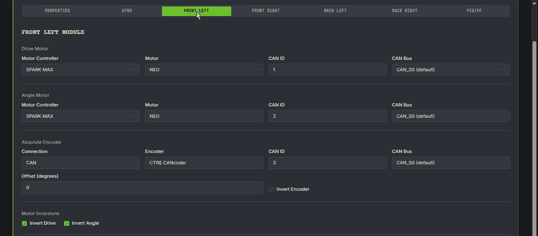<figcaption>
Entering each module's offset in the config generator.
</figcaption></figure>

The absolute encoder offset is what lets your swerve module remember wheel orientation across power cycles. Redeploy once all four are in.



### Run the spin test

With the robot lifted, command pure counterclockwise rotation and watch the modules in AdvantageScope's Swerve view. It should spin cleanly counterclockwise.

<figure>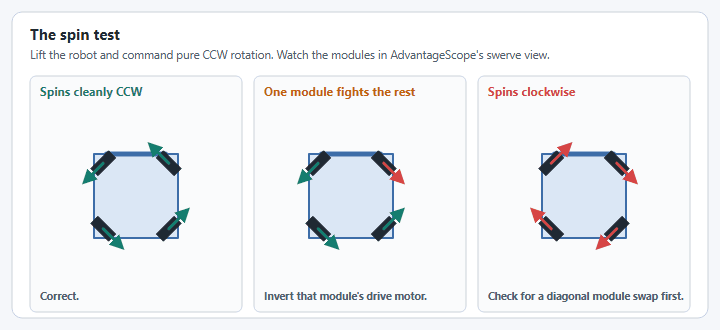<figcaption>
What the spin test can look like.
</figcaption></figure>

You can also run it from the dashboard: with drive tuning on, set `Tuning/swerve/modules/drive/inplace` to `true` and give `modules/drive/velocity` a small positive speed. Every module turns tangent to the robot and it should spin counterclockwise.

<figure>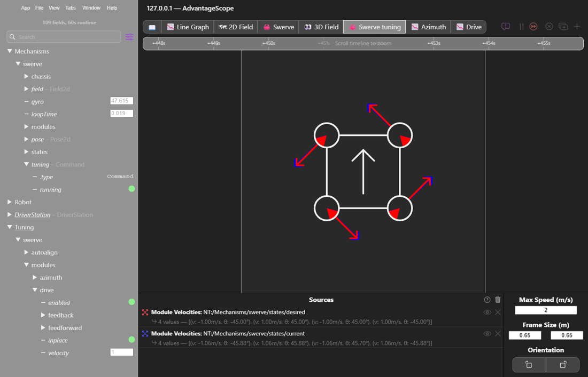<figcaption>
The spin test from the dashboard: modules/drive/inplace on, every module tangent to the robot.
</figcaption></figure>

[Determine Inversion](../fix-a-problem/determine-inversion.md) lists every symptom and its cause.


