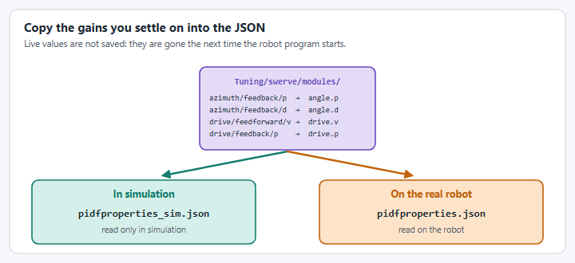

# 7. Tune and drive

With every module checked and its offset recorded, tune the modules on the real robot, then take it for its first drive.

## Tune the modules

Do the live tuning from [step 5](practice-in-simulation.md) again for real, with the same dashboard and the same order: start live tuning, tune the azimuth, then the drive. The animations in step 5 show what to look for.

* **Lift the robot on blocks**, with every wheel clear of the blocks and of the ground. Tuning moves the modules.
* **Enable Utility mode from the Driver Station** instead of the sim GUI, with no op mode selected, then start live tuning in AdvantageScope exactly as in step 5.
* **Start from the gains in `pidfproperties.json`**, not the ones you found in simulation.
* **Copy what you settle on into `pidfproperties.json`**, the file the real robot reads.

<figure><figcaption>
On the real robot, the gains go into pidfproperties.json.
</figcaption></figure>

## First drive

1. Deploy your code to the SystemCore.
2. On blocks, enable the robot in Teleop and push the drive stick gently forward. All four wheels should point the same direction and the robot should attempt to move that way.
3. Rotate with the rotation axis. The robot should spin around its center, not drift while spinning.
4. If a module fights the others (spins to the wrong angle, or drives backward relative to the rest), revisit [step 6](04-verify-and-calibrate-hardware.md) for that module's inversion/offset, or see [Find your problem](../fix-a-problem/fix-a-problem.md).
5. Once it drives cleanly on blocks, test on the ground at low speed before opening it up.

Congratulations, you have a driving swerve robot. If something isn't right, start at [Find your problem](../fix-a-problem/fix-a-problem.md). The **Tune and extend** section covers what comes next: [drive to a pose](../tune-and-extend/drive-to-a-pose.md), [PathPlanner](../tune-and-extend/setup-pathplanner.md) and more.
