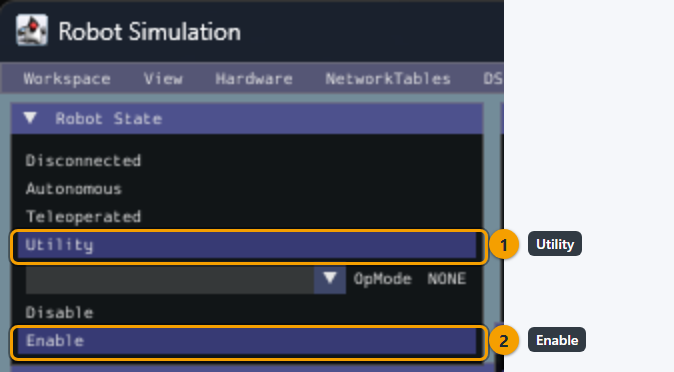
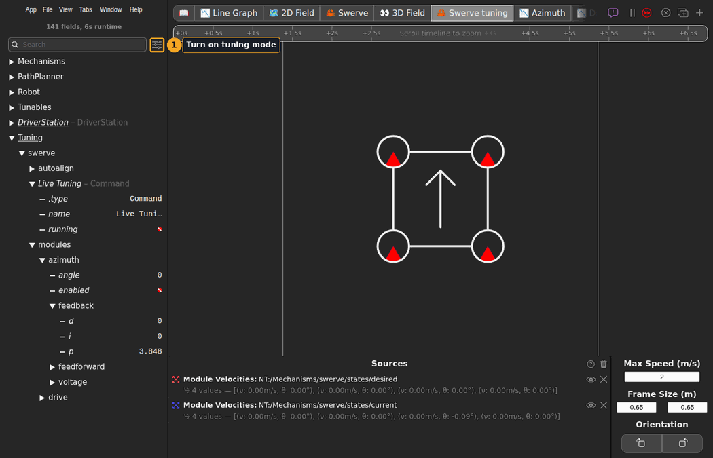
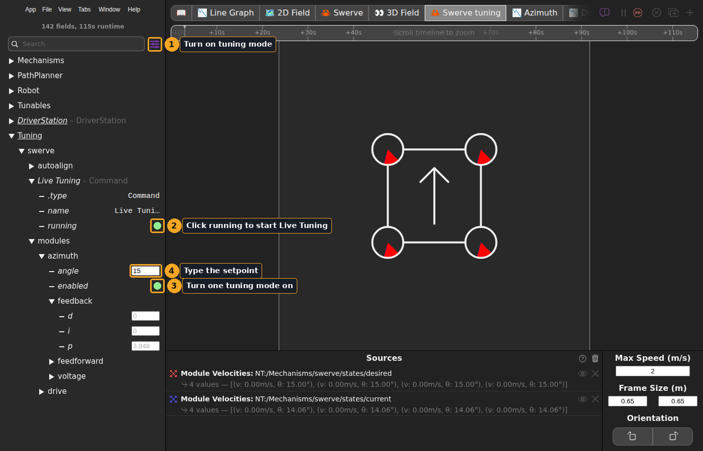
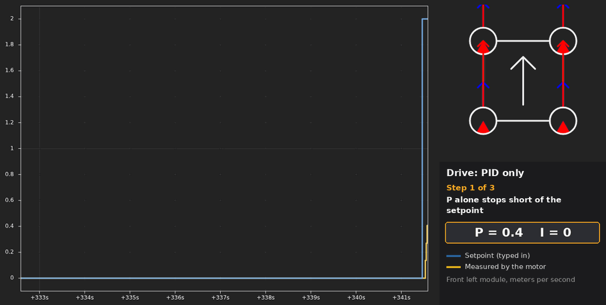
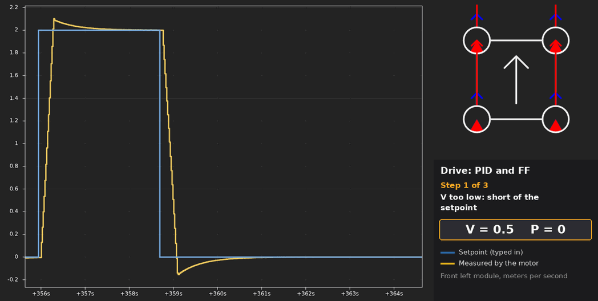
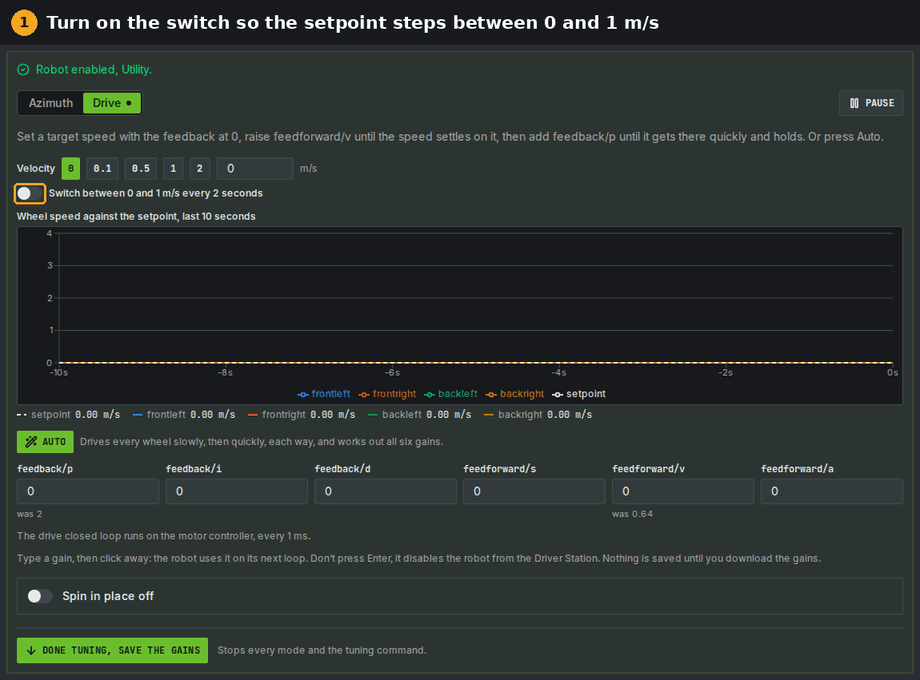
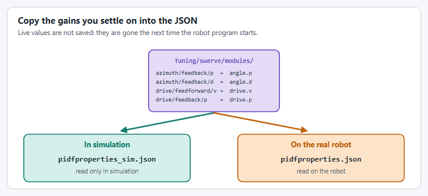

# 5. Practice in simulation

Run the robot program in simulation and go through live tuning once before you touch the real robot. Simulation is practice, not tuning: the gains it finds can't be trusted on the real modules, but it teaches you the dashboard and catches config mistakes while nothing can break. You'll do the same live tuning for real in [step 7](05-deploy-and-drive.md).

Live tuning needs `TelemetryVerbosity.HIGH` and both drive-to-pose controllers, which the code from [step 4](write-the-swerve-code.md) already sets. [Tune PIDF gains](../tune-and-extend/tune-pidf-gains.md#live-tuning) explains each piece.

**Start live tuning.** Enable Utility mode, start the `Tuning/swerve/Live Tuning` command, and turn on one tuning mode. `Tuning/swerve/` values only take effect while the command runs.

<figure><figcaption>
In simulation: in the sim GUI's Robot State panel, pick Utility (1), then Enable (2). Leave the OpMode at NONE, because a teleop op mode would drive the modules and fight the tuning.
</figcaption></figure>

<figure><figcaption>
Starting live tuning in AdvantageScope, recorded in simulation.
</figcaption></figure>

<figure><figcaption>
In AdvantageScope: turn on tuning mode (1), click <code>running</code> to start the tuning command (2), turn one tuning mode on (3), then type the setpoint (4).
</figcaption></figure>

**Tune the azimuth first**, so the wheels point where they're told while you tune the drive. Steering holds a position, and PID alone is enough for that, whichever method you use for the drive.

1. Set `Tuning/swerve/modules/azimuth/enabled` to `true`, then switch `modules/azimuth/angle` between `0` and `45`.
2. Start with a small `feedback/p`. The wheels crawl toward the angle.
3. Raise `feedback/p` until the wheels overshoot the angle and swing back.
4. Add `feedback/d` until the overshoot is gone.

To see it, graph three things for one module, in degrees:

* the angle you typed, `Tuning/swerve/modules/azimuth/angle`;
* the azimuth motor's position, `Mechanisms/swerve/modules/frontleft/azimuth/mechanism/position`;
* the absolute encoder, `Mechanisms/swerve/modules/frontleft/encoder`, added after the motor's position so it's drawn underneath it.

The motor's position and the absolute encoder should line up exactly, so the absolute encoder's line stays hidden. If you can see it, the two readings disagree: check that module's absolute encoder offset, its inversion and the angle gear ratio.

<figure><figcaption>
Azimuth tuning, recorded in simulation: P too low, then overshooting, then D.
</figcaption></figure>

**Then tune the drive.** Turn azimuth tuning off, set `modules/drive/enabled` to `true`, and switch `modules/drive/velocity` between `0` and `2` meters per second. Graph that speed against what a module's drive motor measures, such as `Mechanisms/swerve/modules/frontleft/drive/measurement/velocity`. Both are in meters per second.

Pick one of these methods. PID only is often enough to get started.



Use the feedback gains alone, starting with every gain at `0`.

1. Raise `feedback/p`. The wheels speed up but stop short of the setpoint. More P gets closer, and too much makes the speed shake.
2. Add `feedback/i` until the speed reaches the setpoint. Too much I overshoots.

<figure><figcaption>
PID only, recorded in simulation: P alone stops short, and I closes the gap.
</figcaption></figure>



Feedforward works out the voltage each speed needs, so feedback only fixes small errors. The wheels reach their speed sooner and track paths better than with PID only.

1. With every feedback gain at `0`, raise `feedforward/v` until the speed lands on the setpoint.
2. Add `feedback/p` so it gets there faster and holds.

<figure><figcaption>
PID and FF, recorded in simulation: V lands on the setpoint, then P makes it quicker.
</figcaption></figure>



The config generator's [Quick Start Guide](https://config.yagsl.com/guide#sim-tune) can live-tune from your browser, with a graph of every module and buttons for the setpoint.

1. Turn on **Live**, pick **Address** and connect to `localhost`, the simulator. On the real robot, use the guide's [Tune Real Robot](https://config.yagsl.com/guide#robot-tune) step and your team number.
2. Pick **Drive**, press **Start drive tuning**, tick the safety checks and press **Everything is clear, start**.
3. Turn on **Switch between 0 and 1 m/s every 2 seconds**.
4. Type `feedforward/v`, then click away. Raise it until the speed lands on the setpoint.
5. Type `feedback/p`, then click away, so it gets there faster and holds.

When you're done, **Download pidfproperties.json** gives you the gains to copy into your project. **Azimuth** tunes the steering the same way.

<figure><figcaption>
The config generator's live tuner, connected to the simulator.
</figcaption></figure>

**Or press Auto.** Auto runs the same tests as WPILib's SysId: it drives every wheel slowly, then quickly, each way, and fits the feedforward to how they moved. Then it works out a P to go with it and fills in all six gains. Auto gets close, not perfect, so check its gains against the graph and adjust from there.

In this recording Auto found `feedforward/v` = 0.63, close to the 0.64 found by hand in the other tabs. Its `feedback/p` made the speed shake a little in simulation, so P is lowered to 2 at the end.

<figure><figcaption>
Auto works out the gains with SysId's tests. They're a starting point to check against the graph.
</figcaption></figure>




Apply a value by clicking away from the box. Don't press Enter: it disables the robot from the Driver Station.


The gains in these recordings are what worked for the YAGSL example in simulation. They aren't starting values for your robot.

**Save what you find.** Values typed on the dashboard are gone the next time the robot program starts. In simulation, copy them into `pidfproperties_sim.json`, which YAGSL reads only in simulation.

<figure><figcaption>
Where the live values belong.
</figcaption></figure>

[YAMS' live tuning page](https://yams.yassrobotics.com/documentation/understanding/live-tuning#swerve-drive) covers every swerve tuning key, `feedforward/s`, and auto-align tuning.
