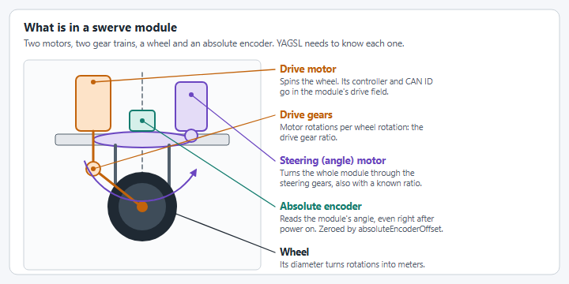

# Swerve Modules

You may see a bunch of different classes in other teams' code which represent a `SwerveModule` and wonder why there isn't a standard class. There is a very good reason for that: every motor, absolute encoder, gear ratio, and installation can be different. YAGSL's JSON configuration exists to describe those differences declaratively instead of in code, and YAMS's `SwerveModule` handles them uniformly underneath.


If you are using a magnetic encoder ensure that the magnet is glued correctly so it does not slip.


## What is in a swerve module?

* [ ] Drive Gears (ratio must be known)
* [ ] Steering Gears (ratio must be known)
* [ ] Drive Motor (+ controller)
* [ ] Angle/Azimuth/Steering Motor (+ controller)
* [ ] Absolute Encoder

<figure><figcaption>
The parts of a swerve module and what YAGSL needs to know about each.
</figcaption></figure>

## Review

This may seem out of place, but it helps during swerve-drive debugging.

Smart Motor Controllers typically have the following features:

* [ ] Rotate in either direction.
* [ ] Have sensors on the motor that read in either direction.
* [ ] Burn up when jammed or unable to move, causing very high amperage utilization.
* [ ] Drop the voltage level available when running.
* [ ] Need a minimum amount of voltage to turn against friction.
* [ ] Greased gears attached to the shaft.
* [ ] Ramp up to speed at a configurable rate to avoid using too much power instantly.
* [ ] Have integrated PID loops which can control the output based on a connected sensor's input (typically an encoder).
* [ ] Are connected to a CAN bus. By default that is the SystemCore's `can_s0`, but it could be another SystemCore bus (`can_s1` to `can_s4`), or the name of a [CANivore](https://store.ctr-electronics.com/canivore/) if one is connected and the motor controller supports it.
* [ ] Rotate the wheel in more than one shaft rotation, proportional to the gears.

All of these need to be set correctly in order to configure a Swerve Module properly. If one of these is not set correctly you might experience behavior that you won't easily be able to identify.

#### TL;DR

1. Motors can break in many ways and are only expected to operate in one way. Refer here while debugging.
2. Swerve Modules contain **drive gears**, **steering gears**, **drive motor**, **steering motor**, and an **absolute encoder**.

## Checklist

* [ ] Steering/Azimuth/Angle motor increases with the absolute encoder value (or is inverted in configuration to match).
* [ ] Steering/Azimuth/Angle motor increases counterclockwise positive.
* [ ] Drive motors increase propelling the robot "forwards".
* [ ] Absolute Encoders are securely seated into the Swerve Module.
* [ ] Gear ratio / conversion is correctly calculated.
* [ ] Absolute encoder offset is configured with the wheel facing the same way on every module.


Wheels should be aligned with the bevels facing the same way to get the absolute encoder offset.


## Absolute Encoder Offsets

Unless your mechanical team is working with extreme precision and places the magnet perfectly centered with the swerve module wheel already straight for every single module, you will need to set an offset for each module so the absolute encoder reads the wheel orientation correctly.


The Absolute Encoder offsets determine where the module should point on boot. When modules do not point straight forwards on boot, or after being commanded to go straight, there **IS** an issue with your Absolute Encoder Offsets.

Sometimes if the offset is off just a little bit a module will be dragged, which could **result in penalties**.


This offset is the `absoluteEncoderOffset` field in each module's JSON config. See the [JSON Schema reference](../reference/json-schema/module-json.md) for the exact field, and the [inversion how-to](../fix-a-problem/determine-inversion.md) for the practical procedure to find it.

## Inversion

Depending on your swerve module, your motors and/or absolute encoder may need to be inverted to run as expected.


When the inversion state of your steering/angle/azimuth motor is incorrect, the Swerve Module **WILL** spin out of control when any input is given, and sometimes even at rest.


Inversion is configured per-module via the `inverted.drive` / `inverted.angle` and `absoluteEncoderInverted` fields. See [When to Invert?](../fix-a-problem/determine-inversion.md).

## Conversion factor and gearing

Math time! Remember dimensional analysis?


Kahn Academy Explanation of Dimensional Analysis for unit conversions


Swerve Modules are given a `SwerveModuleVelocity` object (WPILib 2027's name for `SwerveModuleState`) to set the velocity (meters per second) and angle (degrees) of the module. This means native units (rotations, and rotations per minute) must be converted to velocity and angle units, using the gear ratio between the motor and the wheel/steering mechanism.

The steering conversion takes _**rotations**_ of the rotor (or absolute encoder, if attached to the motor controller's dataport) and converts them to _**degrees**_.

For example, assume the steering gear ratio is `12.8:1` ([SDS MK4 Steering Ratio](https://www.swervedrivespecialties.com/collections/kits/products/mk4-swerve-module)), meaning the rotor spins `12.8` times to complete one mechanism rotation.

$$
SteeringConverionFactor = \frac{1_{degree}}{1_{rot}} = \frac{1_{rot}}{12.8_{rot}} * \frac{1_{rot}}{360_{deg}}
$$

The drive conversion takes _**rotations**_ given by the motor encoder and converts them to _**meters**_.

For example, assume the drive gear ratio is `6.75:1` ([SDS MK4 L2 Drive Ratio](https://www.swervedrivespecialties.com/collections/kits/products/mk4-swerve-module)), meaning the rotor spins `6.75` times for the wheel to complete a rotation.

$$
DriveConversionFactor = \frac{\frac{1_{meter}}{1_{sec}}}{\frac{1_{rot}}{1_{min}}} = \frac{1_{rot}}{1_{min}} * \frac{1_{rot}}{6.75_{rot}} * \frac{60_{sec}}{1_{min}} * \frac{\pi*d_{meters}}{1_{rot}}
$$

All of this is the long way of showing you that math is important, and your gear ratios and wheel diameter are not magic numbers!


Getting this wrong **COULD** cause the motor to spin out of control, or your odometry will always be slightly off, resulting in more exaggerated motion while driving around.


Rather than compute a raw conversion factor yourself, the JSON config expresses `gearRatio` and `diameter` directly (per-module override in `modules/<name>.json`, or the shared default in `physicalproperties.json`) and YAMS derives the conversion internally. See the [JSON Schema reference](../reference/json-schema/physicalproperties-json.md) and [Standard Conversion Factors](../reference/standard-conversion-factors.md) for common COTS module ratios.

## PID Control

PID stands for Proportional-Integral-Derivative. Swerve Drives should try to use the most up-to-date feedback available, typically the motor controller's on-board PID/closed-loop control.

WPILib has a great guide to learning PIDs. The turret position example is exactly how steering motors are controlled.



There are two PID loops involved in a Swerve Module: one for the drive motor, the other for the steering motor.

#### Drive motor PID

Tune it as if it were a flywheel. This is documented here:



The drive motor also benefits from a feedforward, so the PID doesn't have to work against the minimum voltage needed to overcome friction and the robot's weight. See `s`/`v`/`a` in [pidfproperties.json](../reference/json-schema/pidfproperties-json.md).

#### Steering motor PID

The Steering Motor PID controls the angle of the wheel in degrees. A few tricks are necessary to do this effectively:

1. PID wrapping ensures the wheel always chooses the shortest path to the destination angle.
2. Grease your gears often.
3. Calculate the correct gear ratio / conversion.
4. Tune quickly and accurately using a hardware client or Tuner X.

WPILib has documentation on a turret position controller, which is the exact same principle:



See [How to Tune PIDF Gains](../tune-and-extend/tune-pidf-gains.md) for concrete starting points.

## Current Limiting

You must limit the current of your motors to avoid pulling too much power and browning out, typically 20A for steering motors, and 40A for drive motors (the `statorCurrentLimit` field in [physicalproperties.json](../reference/json-schema/physicalproperties-json.md)).


SPARK MAX can only apply stator current limits.



