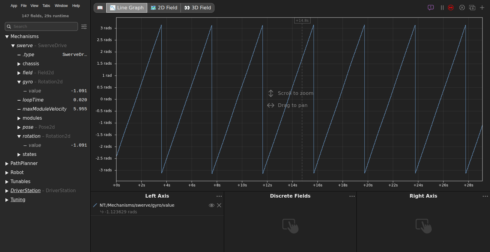

# Telemetry, Simulation & Vision

## Telemetry

YAMS pushes swerve drive and module data to NetworkTables under `Mechanisms/<name>`, where `<name>` is the telemetry name you pass to `SwerveDriveConfig.withTelemetry(name, ...)`. This documentation and the YAGSL examples use `swerve`, so the paths below start with `Mechanisms/swerve`. This is the data most dashboards (Shuffleboard, Elastic, AdvantageScope) read to render swerve widgets. See the [AdvantageScope how-to guide](../tune-and-extend/set-up-advantagescope.md). Every one of these fields is also written to a WPILib DataLog automatically. See [How to view your DataLog in AdvantageScope](../tune-and-extend/view-your-datalog-in-advantagescope.md) to look at a recorded run after the fact.

<figure><figcaption><p>The Mechanisms/swerve NetworkTables tree as seen in AdvantageScope.</p></figcaption></figure>

```
Mechanisms/swerve/
├── .type                   ("SwerveDrive", so a dashboard can recognize the table)
├── loopTime                (seconds)
├── maxModuleVelocity       (meters per second, the fastest a module can drive)
├── pose                    (Pose2d struct)
├── rotation                (Rotation2d struct, the robot's rotation from odometry, used for the module states)
├── gyro                    (Rotation2d struct, the gyro's rotation)
├── chassis/
│   ├── current             (ChassisVelocities struct, robot-relative, measured)
│   ├── desired              (ChassisVelocities struct, robot-relative, commanded)
│   └── field                (ChassisVelocities struct, field-relative)
├── states/
│   ├── current              (SwerveModuleVelocity[] struct array, measured)
│   └── desired               (SwerveModuleVelocity[] struct array, commanded)
└── modules/<name>/
    ├── encoder              (degrees, the module's raw absolute encoder reading)
    ├── drive/                (that module's drive SmartMotorController telemetry)
    │   ├── current/{stator, supply}            (amps)
    │   └── measurement/{position, velocity}    (meters, meters per second)
    └── azimuth/              (that module's angle/steering SmartMotorController telemetry)
        ├── current/{stator, supply}            (amps)
        ├── mechanism/{position, velocity}      (rotations, rotations per second)
        └── externalencoder/{position, velocity} (rotations, rotations per second)
```


Units follow one rule in YAMS: read-only values are published in rotations and rotations per second (meters and meters per second for linear values such as the drive wheel), while values you can edit for live tuning are in degrees and RPM (meters and meters per second for linear values).



`modules/<name>/encoder` is the raw absolute encoder reading, in degrees. This is the value you read to determine `absoluteEncoderOffset` for that module. It sits directly under the module's table, as a sibling of `drive` and `azimuth`, not nested inside either of them.


How much gets published is controlled by `yams.core.telemetry.enums.TelemetryVerbosity`:

```java
public enum TelemetryVerbosity {
  LOW,   // everything a dashboard's swerve widget needs
  MID,   // adds the field-relative chassis speeds
  HIGH   // adds the live tuning values
}
```

| Verbosity | Swerve drive fields                                                                                                          |
| --------- | ---------------------------------------------------------------------------------------------------------------------------- |
| `LOW`     | `pose`, `rotation`, `gyro`, `states/current`, `states/desired`, `chassis/current`, `chassis/desired` and `maxModuleVelocity` |
| `MID`     | `LOW`'s, and `chassis/field`                                                                                                 |
| `HIGH`    | `MID`'s, and the gains and setpoints for [live tuning](../tune-and-extend/tune-pidf-gains.md)                                |

`.type` is published at every verbosity. `maxModuleVelocity` is the maximum module speed YAGSL works out from your motors, gearing and wheel size.

```java
var cfg = new SwerveDriveConfig()
    .withSubsystem(this) // .withMechanism(this) for Commands v3
    .withTelemetry("swerve", new SwerveDriveTelemetryConfig(TelemetryVerbosity.HIGH));

SwerveParser.parse(directory);
drive = SwerveParser.createSwerveDrive(cfg);
```

`withTelemetry("swerve", TelemetryVerbosity.HIGH)` is the short form. Passing a `SwerveDriveTelemetryConfig` (`yams.core.telemetry.SwerveDriveTelemetryConfig`) also lets you choose the DataLog name with `.withDataLogName(...)`; with the short form, YAGSL logs under `Swerve/`. The DataLog is on by default, so every run is recorded; see [View your DataLog in AdvantageScope](../tune-and-extend/view-your-datalog-in-advantagescope.md).

Telemetry is only published while your code calls `drive.updateTelemetry()` every loop: from the subsystem's `periodic()` in Commands v2, or from `robotPeriodic()` in Commands v3, where a `Mechanism` has no `periodic()` of its own.


Higher telemetry verbosity can induce some lag on the robot and slow down loop cycle times. Be deliberate about what you choose, especially in competition.


### Reading module telemetry while bringing up a robot

The most useful pair of values while bringing up a new robot are `modules/<name>/encoder` (the raw absolute encoder, in degrees) and `modules/<name>/azimuth/mechanism/position` (the angle mechanism's position as the motor controller sees it, in rotations):

* If the absolute encoder decreases while the module is rotated counter-clockwise (should be CCW+), set `absoluteEncoderInverted` for that module.
* If the drive or angle motor's telemetry decreases when it should be increasing (or vice versa), invert that motor in `inverted.drive`/`inverted.angle`.

See [Determine Motor/Encoder Inversion](../fix-a-problem/determine-inversion.md) for the full procedure.

## Simulation

YAMS simulates the whole swerve drive using the same vendor simulation models as the real hardware, to varying degrees of fidelity per vendor. All you need to do is call `simIterate()` from your subsystem's `simulationPeriodic()` (in Commands v3, from your robot class's `simulationPeriodic()`):

```java
@Override
public void simulationPeriodic()
{
  drive.simIterate();
}
```


[Cosine compensation](module-behaviors.md#cosine-compensation) is tuned for real hardware behavior and can look wrong in simulation. This is expected, not a bug in your config.


If `modules/pidfproperties_sim.json` exists in your config directory, YAGSL reads it in place of `modules/pidfproperties.json` while running in simulation, so simulation gains can differ from the real robot's. The config generator includes one in every download.

For more on WPILib's simulation framework generally:



## Vision Odometry

YAMS's `SwerveDrive` maintains a `SwerveDrivePoseEstimator` internally, and extends its vision-fusion API directly onto `SwerveDrive` so you don't need to construct or manage your own estimator:

```java
drive.addVisionMeasurement(visionPose, timestampSeconds);

// Or with per-measurement standard deviations:
drive.addVisionMeasurement(visionPose, timestampSeconds, visionStdDevs);

// Or set a persistent default:
drive.setVisionMeasurementStdDevs(visionStdDevs);
```

Feed this from your vision subsystem (PhotonVision, Limelight, etc.) every time a new pose estimate is available. To draw vision poses or targets on the dashboard, add them to the drive's own field with `drive.getField2d()` instead of creating a second `Field2d`. Standard deviations control how much the pose estimator trusts a given vision measurement relative to odometry: tighter (smaller) values pull the estimate toward vision more aggressively; looser (larger) values let odometry dominate. Tune these empirically; see [Swerve Drive Drift Causes](../fix-a-problem/swerve-drift-causes.md) if pose estimates drift or jump unexpectedly.
