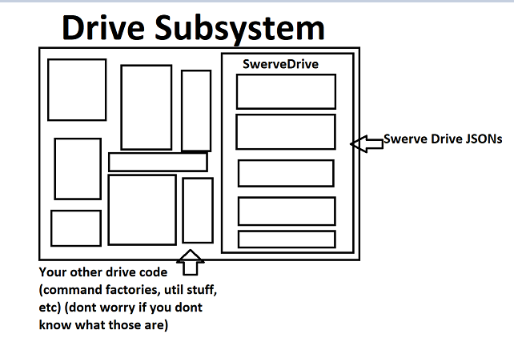

# What is YAGSL?

## Where does YAGSL fit into my program?

**YAGSL is a thin JSON configuration parser that builds a** [**YAMS**](https://yams.yamgen.com/) **`SwerveDrive`.**

YAMS ([Yet Another Mechanism Suite](https://yams.yamgen.com/)) is a general-purpose FRC mechanism library: arms, elevators, flywheels, and swerve drives all share the same underlying `SmartMotorController` abstraction, feedforward/feedback plumbing, simulation support, and telemetry. YAMS's `SwerveDrive` (`yams.commands2.swerve.SwerveDrive` for Commands v2, `yams.commands3.swerve.SwerveDrive` for Commands v3) is a complete, hardware-agnostic swerve implementation in its own right; it does not need YAGSL to function.

What YAGSL adds on top is the part FRC teams actually re-do every season: turning a description of _your_ robot's hardware (which motor controllers, which absolute encoders, which gyro, what gear ratios, where each module sits) into the Java objects YAMS needs (`SwerveDriveConfig`, `SwerveModuleConfig`, and `SmartMotorControllerConfig`) without you hand-writing that boilerplate for every robot.

YAGSL 2027 is built on WPILib 2027 (`2027_alpha7`, Java 25) and runs on the SystemCore.

<figure><figcaption><p>Diagram depicting a drive subsystem and where <code>SwerveDrive</code> fits into one. (created by DeltaDizzy)</p></figcaption></figure>

## How the pieces fit together

1. You describe your robot's hardware as JSON files (`swervedrive.json`, and per-module files under `modules/`), generated for you by [**config.yagsl.com**](https://config.yagsl.com), or hand-written if you prefer.
2. `SwerveParser.parse(directory)` reads that JSON. `SwerveParser` is `swervelib.commands2.SwerveParser` or `swervelib.commands3.SwerveParser`, depending on your command framework. Both extend the framework agnostic `swervelib.core.parser.SwerveParser`, which resolves each device string (e.g. `sparkflex_neo`, `cancoder_can`) to the right vendor hardware wrapper and builds a YAMS `SwerveModuleConfig`/`SmartMotorControllerConfig` per module.
3. `SwerveParser.createSwerveDrive(SwerveDriveConfig)` hands those configs to YAMS, which constructs and returns a ready-to-drive `SwerveDrive` for your command framework, bound to the `Subsystem` (Commands v2) or `Mechanism` (Commands v3) in your `SwerveDriveConfig`.
4. From there, everything (kinematics, odometry, telemetry, simulation, vision fusion, driver-input shaping via `SwerveInputStream`) is YAMS's API, documented in the [YAMS API reference](../reference/api-reference.md). YAGSL only exists at the boundary between "JSON describing my robot" and "a working `SwerveDrive` object."



```java
// import swervelib.commands2.SwerveParser;
// import yams.commands2.config.SwerveDriveConfig;
// import yams.commands2.swerve.SwerveDrive;
var cfg = new SwerveDriveConfig()
    .withStartingPose(new Pose2d(3, 3, Rotation2d.ZERO))
    .withSubsystem(this)
    .withTelemetry("swerve", new SwerveDriveTelemetryConfig(TelemetryVerbosity.HIGH));

SwerveParser.parse(new File(Filesystem.getDeployDirectory(), "swerve/base"));
drive = SwerveParser.createSwerveDrive(cfg);
```



```java
// import swervelib.commands3.SwerveParser;
// import yams.commands3.config.SwerveDriveConfig;
// import yams.commands3.swerve.SwerveDrive;
var cfg = new SwerveDriveConfig()
    .withStartingPose(new Pose2d(3, 3, Rotation2d.ZERO))
    .withMechanism(this)
    .withTelemetry("swerve", new SwerveDriveTelemetryConfig(TelemetryVerbosity.HIGH));

SwerveParser.parse(new File(Filesystem.getDeployDirectory(), "swerve/base"));
drive = SwerveParser.createSwerveDrive(cfg);
```



`parse` and `createSwerveDrive` are static methods, so you never construct a `SwerveParser`.

## What YAGSL depends on

YAGSL is published as two vendordeps, `yagsl_commands2.json` and `yagsl_commands3.json`. Each one ships the shared `YAGSL-core` artifact plus `YAGSL-commands2` or `YAGSL-commands3`, and you install exactly one of them. See [Install YAGSL](../get-started/02-install-yagsl.md).

The only library a YAGSL vendordep requires is the matching YAMS vendordep. Hardware vendor libraries (Phoenix 6, REVLib, ReduxLib, ThriftyLib and so on) are optional: the classes that touch a vendor's API are loaded by reflection, and only when your JSON configuration uses one of that vendor's devices. A robot with only CTRE hardware never needs REVLib installed, and the other way around. If a configuration names a device whose vendor library is missing, creating the swerve drive fails when the robot program starts.


If you already know YAMS, or you outgrow what the JSON schema can express, you can always construct `SwerveDriveConfig`/`SwerveModuleConfig` yourself and skip `SwerveParser` entirely. It is a convenience layer, not a requirement.


## Our Philosophy

Your program does not revolve around your swerve drive. Your constants file doesn't have to take 10 minutes to find the right option. Different robots should be able to work with the same code: swap the `swerve/` config directory and the same subsystem code drives a different robot.

## Why do we exist?

Most swerve drive code out there is a template that teams are expected to modify and fit to their robot: not generic, and requiring a lot of time and effort to get working. Even after all that effort, bugs can hide in code you copied and never fully understood. There is a better way.

Do you have multiple robots and don't want to change any code to get them to work the same? Create a configuration directory, point `SwerveParser` at it, and go.

## Goals of this documentation

* Teach the fundamentals of a `SwerveDrive` and `SwerveModule` so you can debug and reason about your robot, even though YAMS builds the actual objects for you. See [Swerve Drive Kinematics](swerve-drive-kinematics.md) and [Swerve Modules](swerve-modules.md).
* Walk you through generating a configuration and bringing up your first YAGSL-driven robot. See the [Tutorial](../get-started/tutorial.md).
* Help you fix the problems every swerve team eventually runs into. See [Find your problem](../fix-a-problem/fix-a-problem.md).
* Give you recipes for tuning and extending a driving robot. See [Tune and extend](../tune-and-extend/how-to.md).
* Document the current JSON schema and hardware support precisely. See the [Reference](../reference/reference.md) section.
