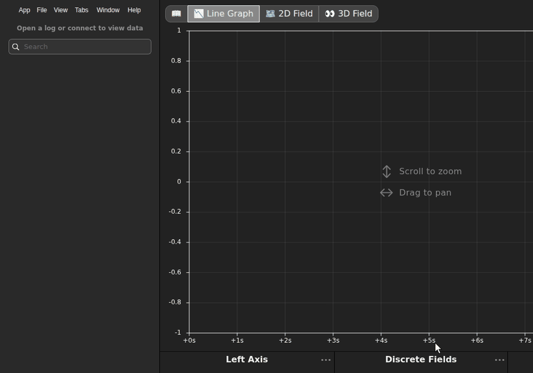
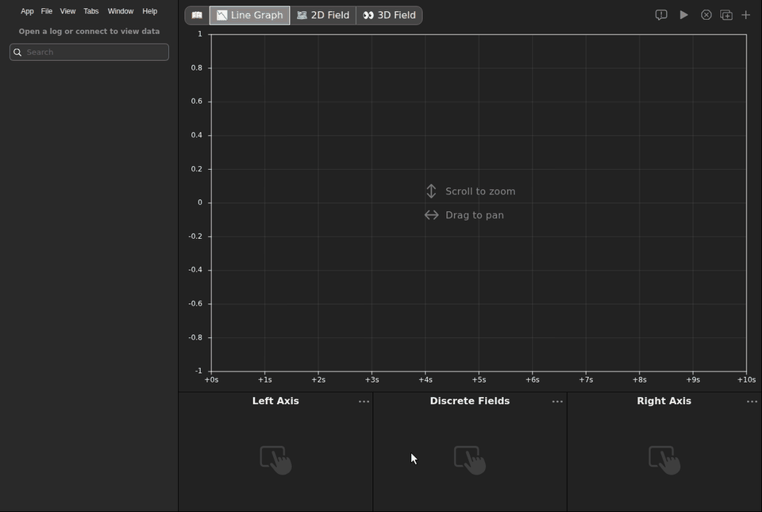
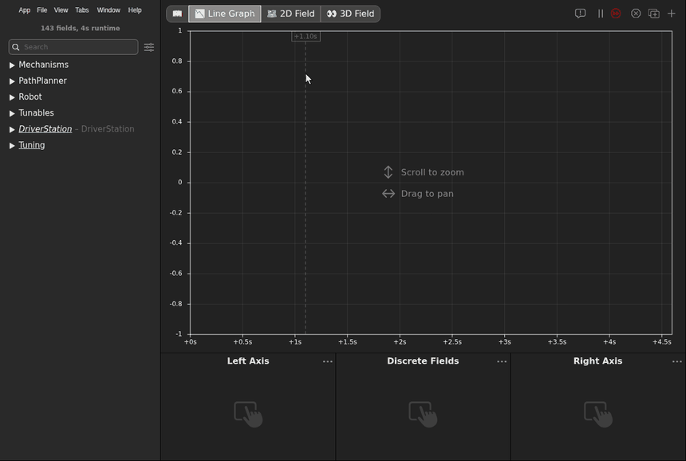

# Set up AdvantageScope

[AdvantageScope](https://github.com/Mechanical-Advantage/AdvantageScope) is included with WPILib, so there is no separate download. With every WPILib update, re-run the [WPILib installer](https://docs.wpilib.org/en/stable/docs/zero-to-robot/step-2/wpilib-setup.html) to get the latest tools.



### Open AdvantageScope

Open `AdvantageScope (WPILib)`, or in VS Code open the command palette, run **WPILib: Start Tool**, and click **AdvantageScope**.



### Set the robot address

Click **App → Show Preferences**. In **Robot Address**, enter the SystemCore's address for your team number, `10.TE.AM.2` (team 1234 is `10.12.34.2`), and click the check mark.

<figure><figcaption>
Setting the robot address in App → Show Preferences.
</figcaption></figure>

Connected to the SystemCore over USB, or to its built-in Wi-Fi access point? Click **File → Use Systemcore USB Address** or **File → Use Systemcore Wi-Fi Address** instead.



### Connect to the robot or the simulator

Click **File → Connect to Robot → Default: NetworkTables**. To watch the simulator instead, click **File → Connect to Simulator → Default: NetworkTables**. The robot's fields appear in the sidebar.

<figure><figcaption>
Connecting to the simulator.
</figcaption></figure>



### Add a Swerve tab

Click **+** at the top right, then **Swerve**. In the sidebar, open **Mechanisms → swerve**, then drag each of these fields into **Sources**:

* `Mechanisms/swerve/states/current`
* `Mechanisms/swerve/states/desired`
* `Mechanisms/swerve/chassis/current`
* `Mechanisms/swerve/chassis/desired`

<figure><figcaption>
Adding the swerve fields to a Swerve tab.
</figcaption></figure>


You may need to enable your robot before AdvantageScope shows values for these fields.



`swerve` is the telemetry name you gave the drive with `SwerveDriveConfig.withTelemetry("swerve", ...)`; if you named it something else, look under `Mechanisms/<that name>`. All four fields are published at every `TelemetryVerbosity`, `LOW` included.


To see the robot's pose on a 2D/3D field, add a **2D Field** or **3D Field** tab instead and drag in `Mechanisms/swerve/pose`.



## Reading the display

Each source is drawn in the color shown beside it in **Sources**. Added in the order above, the **blue** arrows are each module's measured velocity and the **red** arrows are the velocity it was commanded to. The **green** and **orange** arrows are the robot's measured and commanded velocity.

Large, persistent gaps between the measured and commanded arrows usually point to a tuning issue. See [how to tune PIDF gains](tune-pidf-gains.md) and [swerve drive drift causes](../fix-a-problem/swerve-drift-causes.md).
