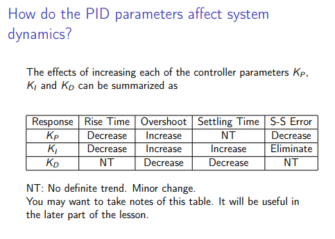
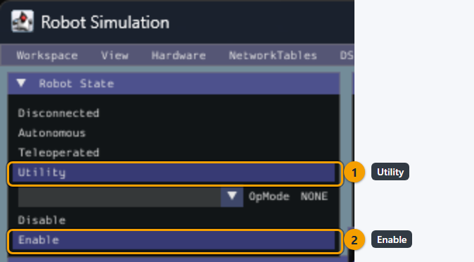
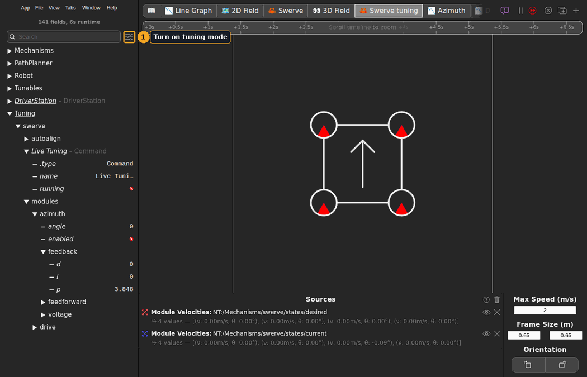
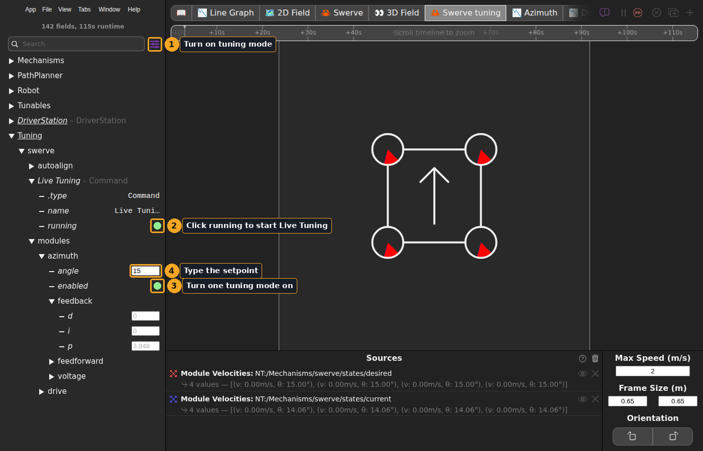
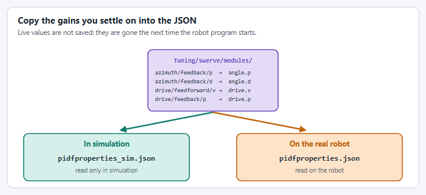

# Tune PIDF gains


Swerve steering/angle/azimuth motors have PID wrapping enabled at the topmost and bottommost point (e.g. "front" and "back"). When tuning angle PID you may want to test with left or right translation so the module doesn't cross the wrap point.


## The basic idea

YAGSL reads PIDF values from [`pidfproperties.json`](../reference/json-schema/pidfproperties-json.md) in your module folder. Generate or edit it with [**config.yagsl.com**](https://config.yagsl.com).

This has been hashed and boiled down to the simplest form like this before:

* **P**: if you're not where you want to be, get there.
* **I**: if you haven't been where you want to be for a long time, get there faster.
* **D**: if you're getting close to where you want to be, slow down.
  * [Video](https://www.youtube.com/watch?v=qKy98Cbcltw) found by 78, found by [this CD post](https://www.chiefdelphi.com/t/finally-i-understand-pid/450811)

<figure><figcaption></figcaption></figure>

## Tuning procedure

Another good way to describe it, [from CTRE](https://pro.docs.ctr-electronics.com/en/latest/docs/api-reference/device-specific/talonfx/closed-loop-requests.html):

Manual tuning typically follows this process:

1. Set $$P$$, $$I$$, and $$D$$ to zero.
2. Increase $$P$$ until the output **starts** to **oscillate** **around** the setpoint.
3. Increase $$D$$ as much as possible **without** introducing **jittering** to the response.

For the drive motor, also set the feedforward terms (`s`, `v`, `a`; see below) before fine-tuning `P`; a good feedforward means `P` only has to correct small errors.

## WPILib walkthrough

WPILib has lots of great documentation on PID, so it's worth reading directly:


Basics of PID



Tuning velocity, like the drive motors!



Tuning position, like the steering/angle/azimuth motors!


## The current `pidfproperties.json` shape


The schema changed in YAGSL 2026.8.05; `f` and `iz` (integral zone) and the old `output` clamp are gone. Feedforward is now expressed as `s`/`v`/`a` (`kS`/`kV`/`kA`, matching WPILib's `SimpleMotorFeedforward`). See the [schema changes reference](../upgrading/schema-changes.md) if you're migrating an older config by hand.


```json
{
  "drive": {
    "p": 1,
    "i": 0,
    "d": 0,
    "s": 0,
    "v": 0,
    "a": 0
  },
  "angle": {
    "p": 40,
    "i": 0,
    "d": 0.3,
    "s": 0,
    "v": 0,
    "a": 0
  }
}
```

These are the generator's starting gains for SparkMAX NEO modules.

If you leave drive `v` (kV) at `0`, YAGSL auto-derives it from the drive motor's free speed and your gearing, so a reasonable feedforward exists even before you've tuned anything by hand.

You can also add a `pidfproperties_sim.json` alongside it. YAGSL will load that one instead when running in simulation (`RobotBase.isSimulation()`), so you can use looser gains in sim without touching your competition robot's config.

## Starting points

The config generator fills these in when you pick a motor type, so a generated `pidfproperties.json` already has them. They were checked in YAGSL's simulation on 5.36:1 and 6.75:1 drive gearing, and 12.8:1, 18.75:1 and 21.43:1 azimuth gearing. Your robot will still need tuning, but they're close enough to drive.

* They're PID only. `i` and the feedforward (`s`, `v`, `a`) start at `0`. With drive `v` at `0`, YAGSL works out the drive's kV from the motor's free speed and your gearing.
* Drive gains are in volts per wheel rotation per second of error. Angle gains are in volts per rotation of error. The gains no longer depend on the motor controller's own units, so old SparkMAX values like `0.0020645` are far too small.



| Motor                              | Drive `p` | Angle `p` | Angle `d` |
| ---------------------------------- | --------- | --------- | --------- |
| Kraken X60, Kraken X44, Falcon 500 | 1         | 15        | 0.3       |



The Pulsar gains are the NEO gains, unchecked: the TalonFXS simulation of the Pulsar does not drive.

| Motor                        | Drive `p` | Angle `p` | Angle `d` |
| ---------------------------- | --------- | --------- | --------- |
| NEO, NEO 2.0, Vortex, Minion | 1         | 15        | 0.3       |
| NEO 550                      | 1         | 8         | 0.6       |
| Pulsar                       | 1         | 15        | 0.3       |



| Motor                | Drive `p` | Angle `p` | Angle `d` |
| -------------------- | --------- | --------- | --------- |
| NEO, NEO 2.0, Vortex | 1         | 40        | 0.3       |
| Minion, Pulsar       | 1         | 30        | 0.3       |
| NEO 550              | 4         | 12        | 0.6       |



| Motor                | Drive `p` | Angle `p` | Angle `d` |
| -------------------- | --------- | --------- | --------- |
| NEO, NEO 2.0, Vortex | 2         | 40        | 0.3       |
| Minion, Pulsar       | 2         | 30        | 0.3       |
| NEO 550              | 4         | 12        | 0.6       |



Once you have a reasonable starting point, use [**config.yagsl.com**](https://config.yagsl.com) to regenerate `pidfproperties.json` with your updated numbers, or hand-edit the file directly. Both work, since the parser only cares about the final JSON.

## Live tuning

You don't have to redeploy for every gain change. YAMS publishes the drive's gains and setpoints to NetworkTables, so you can change them from a dashboard (Elastic, AdvantageScope) while the robot runs. The **Tuning Guide** at [config.yagsl.com](https://config.yagsl.com) walks through the full process; these are the pieces it uses.

Live tuning needs `TelemetryVerbosity.HIGH` on the drive and both drive-to-pose controllers. YAMS only publishes the tuning command when both controllers are configured, even if you only want to tune the modules:

```java
var cfg = new SwerveDriveConfig()
    .withSubsystem(this) // withMechanism(this) on Commands v3
    .withTranslationController(new PIDController(4, 0, 0))
    .withRotationController(new PIDController(3, 0, 0))
    .withTelemetry("swerve", new SwerveDriveTelemetryConfig(TelemetryVerbosity.HIGH));
```

1. **Start in simulation**, or with the robot on blocks. Tuning moves the robot.
2.  **Enable Utility mode** (formerly Test) and make sure nothing else is commanding the drive. The Commands v2 example holds the drive with an idle command so the default drive command can't fight the tuning command:

    ```java
    RobotModeTriggers.utility().whileTrue(Commands.idle(swerve).withName("Live Tuning"));
    ```
3. **Start the tuning command** YAMS publishes as `Tuning/swerve/Live Tuning` (click it in your dashboard, or set its `running` entry to `true`). YAMS releases before 2026.11.03 published it under `Mechanisms/swerve/tuning`. Values under `Tuning/swerve/` only take effect while it runs.
4. **Turn on one tuning mode** below and adjust its values. Only one mode drives at a time; if you enable more than one, auto-align wins over drive tuning, and drive tuning wins over azimuth tuning.
5. **Copy the gains you settle on back** into `pidfproperties.json` (module gains) or your `SwerveDriveConfig` (drive-to-pose controllers). Live values are not saved and are gone on the next code restart.

`swerve` in these paths is the telemetry name from `withTelemetry("swerve", ...)`.

<figure><figcaption><p>In simulation: in the sim GUI's Robot State panel, pick Utility (1), then Enable (2). Leave the OpMode at NONE, because a teleop op mode would drive the modules and fight the tuning.</p></figcaption></figure>

<figure><figcaption><p>Starting live tuning in AdvantageScope, recorded in simulation.</p></figcaption></figure>

<figure><figcaption><p>In AdvantageScope: turn on tuning mode (1), click <code>running</code> to start the tuning command (2), turn one tuning mode on (3), then type the setpoint (4).</p></figcaption></figure>

Then tune the azimuth, then the drive. [Practice in simulation](../get-started/practice-in-simulation.md) walks through both with recordings, and shows three ways to tune the drive: PID only, PID and FF, or the config generator's live tuner.

<figure><figcaption><p>Where the live values belong.</p></figcaption></figure>

[YAMS' live tuning page](https://yams.yassrobotics.com/documentation/understanding/live-tuning#swerve-drive) walks through each swerve tuning mode step by step.

| Key (under `Tuning/swerve/`)                | What it does                                                                                                                     | Unit you type           |
| ------------------------------------------- | -------------------------------------------------------------------------------------------------------------------------------- | ----------------------- |
| `modules/drive/enabled`                     | Drive tuning: drive every module at `modules/drive/velocity`                                                                     | boolean                 |
| `modules/drive/velocity`                    | Drive velocity setpoint                                                                                                          | meters per second       |
| `modules/drive/inplace`                     | Point the modules tangent to the robot, so a positive velocity spins it in place (counter-clockwise) instead of driving straight | boolean                 |
| `modules/drive/feedback/p`, `/i`, `/d`      | Drive motor PID (`drive.p`/`i`/`d` in `pidfproperties.json`)                                                                     | same as the JSON        |
| `modules/drive/feedforward/s`, `/v`, `/a`   | Drive motor feedforward (`drive.s`/`v`/`a`)                                                                                      | same as the JSON        |
| `modules/azimuth/enabled`                   | Azimuth tuning: point every module at `modules/azimuth/angle`                                                                    | boolean                 |
| `modules/azimuth/angle`                     | Azimuth angle setpoint                                                                                                           | degrees                 |
| `modules/azimuth/feedback/p`, `/i`, `/d`    | Azimuth motor PID (`angle.p`/`i`/`d`)                                                                                            | same as the JSON        |
| `modules/azimuth/feedforward/s`, `/v`, `/a` | Azimuth motor feedforward (`angle.s`/`v`/`a`)                                                                                    | same as the JSON        |
| `autoalign/enabled`                         | Auto-align tuning: drive to `autoalign/setpoint/*` with the drive-to-pose controllers                                            | boolean                 |
| `autoalign/setpoint/x`, `/y`, `/rot`        | Auto-align target pose (field relative, blue origin)                                                                             | meters, meters, degrees |
| `autoalign/translation/p`, `/i`, `/d`       | Translation controller (see [drive to a pose](drive-to-a-pose.md))                                                               | per meter of error      |
| `autoalign/rotation/p`, `/i`, `/d`          | Rotation controller                                                                                                              | per radian of error     |


**The units you type are not the units you read back.** YAMS' tunable fields use the units people think in: **degrees** and **RPM** for rotating mechanisms, **meters** and **meters per second** for linear ones (a swerve drive wheel is linear, so its velocity setpoint is in m/s). The read-only telemetry it publishes next to them, under `Mechanisms/swerve/...`, is in **rotations** and **rotations per second** (meters and m/s for linear measurements). So an azimuth setpoint of `90` (degrees) shows up as a `mechanism/position` of `0.25` (rotations). Check which table you're looking at before deciding a loop is "off by 360."


| Quantity                       | Tunable (under `Tuning/`) | Read-only telemetry (under `Mechanisms/`) |
| ------------------------------ | ------------------------- | ----------------------------------------- |
| Angular position               | degrees                   | rotations                                 |
| Angular velocity               | RPM                       | rotations per second                      |
| Linear position                | meters                    | meters                                    |
| Linear velocity                | meters per second         | meters per second                         |
| Gyro heading, absolute encoder | n/a                       | degrees                                   |


The example README lists one known issue for this release: dashboard auto-align only drives correctly while the robot faces 0° (away from the blue driver station). Zero the gyro facing 0° before enabling `autoalign/enabled`. The `driveToPose` commands themselves are not affected.

