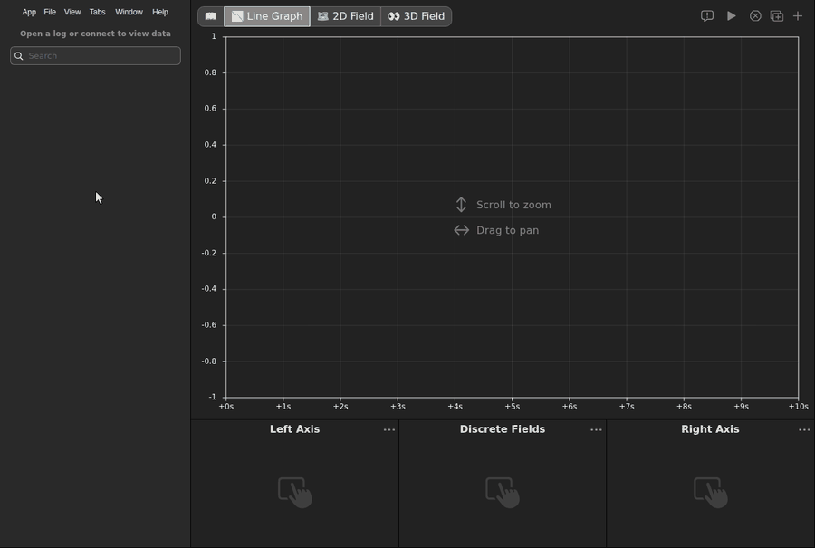
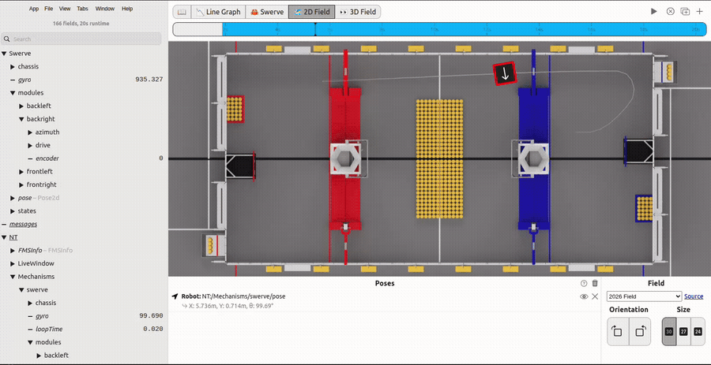
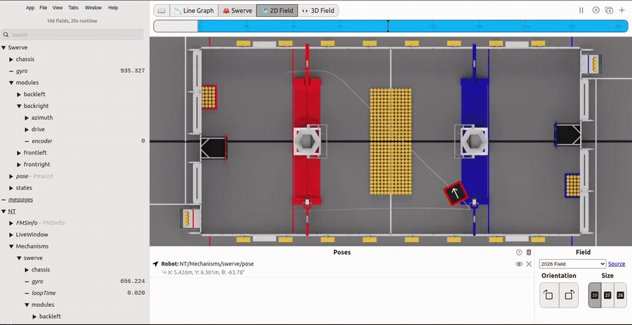
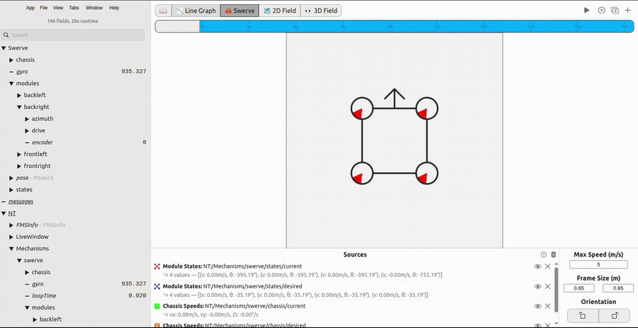

# View your DataLog in AdvantageScope


**This is not "Log Replay."** [AdvantageKit's Log Replay](https://docs.advantagekit.org/getting-started/what-is-advantagekit) re-runs your robot code against a recorded log to deterministically reproduce a match in simulation, and requires the AdvantageKit IO-interface pattern. What this page covers is simpler and works with **every** YAGSL robot, AdvantageKit or not: opening the `.wpilog` file your robot already wrote and looking at the recorded values in AdvantageScope. Nothing re-executes; you're just viewing a file.



**DataLog is on by default.** YAGSL records a DataLog every time your robot code runs, on the robot and in simulation, with the swerve drive under `Swerve/`. You don't need to set anything up: drive a match or a practice, then skip ahead to pulling the file. The first two steps are optional.


YAGSL's swerve telemetry is written to a WPILib `DataLog` as well as published to NetworkTables. See [Telemetry, Simulation & Vision](../how-it-works/telemetry-and-vision.md) for the live NetworkTables tree; this page is the practical walkthrough for looking at a _recorded_ run afterward.



### Start the DataLog at power-on (optional)

`DataLogManager` owns the actual file on disk. It starts on its own, but you can start it yourself once, early, in your `Robot` constructor (WPILib 2027 has no `robotInit()`):

```java
import org.wpilib.driverstation.DriverStation;
import org.wpilib.system.DataLogManager;

public Robot() {
  DataLogManager.start();
  DriverStation.startDataLog(DataLogManager.getLog()); // optional: also logs joystick/DS data
}
```


If you never call `DataLogManager.start()` yourself, it still starts lazily the first time YAMS creates a DataLog entry. Calling it explicitly, before you build the swerve drive, guarantees the log begins at power-on and lets you fold in DS/joystick data with `DriverStation.startDataLog(...)`.


On the real robot, `.wpilog` files are written to a `logs` folder on a USB drive if one is plugged in (`/u/logs`), otherwise to `/home/systemcore/logs` on the SystemCore's internal storage. In simulation, they land in your project's `logs/` folder next to `build.gradle`. WPILib initially names the file `WPILIB_TBD_<random>.wpilog` and renames it to a UTC timestamp (e.g. `WPILIB_20261009_010558.wpilog`) once the Driver Station connects, or to `WPILIB_<timestamp>_<event>_<match>.wpilog` when the FMS provides a match number.


`WPILIB_TBD_*` files left over from a previous boot are deleted on startup, and the oldest logs are deleted when the storage has less than 50 MB free. Pull the logs you care about off the robot.




### Change the swerve drive's DataLog name (optional)

By default `DataLogManager` records every NetworkTables value change, so everything under `Mechanisms/swerve` is already in the file (as `NT:/Mechanisms/swerve/...`) without any setup. YAGSL also writes YAMS' dedicated DataLog entries under `Swerve/`, which keep recording when you turn NetworkTables publishing off for competition. To use a different name, set it on the telemetry config you pass to `SwerveDriveConfig`:

```java
import yams.core.telemetry.SwerveDriveTelemetryConfig;
import yams.core.telemetry.enums.TelemetryVerbosity;

var cfg = new SwerveDriveConfig()
    .withSubsystem(this) // withMechanism(this) on Commands v3
    .withTelemetry("swerve", new SwerveDriveTelemetryConfig(TelemetryVerbosity.HIGH)
        .withDataLogName("Swerve"));
```

`SwerveParser` then derives a DataLog name for every module and motor from that one name:

* `Swerve`: the drive itself (pose, rotation, gyro, chassis speeds, module states).
* `Swerve/modules/<name>`: that module's absolute encoder and state.
* `Swerve/modules/<name>/drive`: that module's drive motor.
* `Swerve/modules/<name>/azimuth`: that module's angle/steering motor.

Numeric entries have their unit inserted after that prefix, for example `Swerve/meters_per_second/maxModuleVelocity`, `Swerve/modules/frontleft/degrees/encoder`, or `Swerve/modules/frontleft/azimuth/rotations/mechanism/position`. Struct entries such as `Swerve/pose`, `Swerve/rotation`, `Swerve/gyro` and `Swerve/states/current` do not. Tunable (live tuning) fields are never written to the DataLog.


If you use the shorter `withTelemetry("swerve", TelemetryVerbosity.HIGH)` overload instead, `SwerveParser` names the drive's DataLog `Swerve` for you, but only the drive-level entries are created, not the per-module or per-motor ones. Pass a `SwerveDriveTelemetryConfig` with `withDataLogName(...)` as above to get all of them. A `SwerveDriveTelemetryConfig` without a DataLog name creates no dedicated entries at all (the `NT:` mirror is still recorded).



Note the DataLog tree uses a top-level `Swerve` (the name you chose, no `Mechanisms` prefix), a _different_ root than the live NetworkTables tree covered in [Telemetry, Simulation & Vision](../how-it-works/telemetry-and-vision.md) (`Mechanisms/swerve`, from the telemetry name). Both describe the same data; AdvantageScope shows them as two separate branches in the field tree (`Swerve` for the DataLog-only entries, `NT` for the mirrored NetworkTables ones). See the sidebar in the screenshots below.


Which fields exist depends on the `TelemetryVerbosity`: `LOW` logs the pose, the gyro, the measured and desired module states and robot-relative chassis speeds, and the maximum module velocity; `MID` adds the field-relative chassis speeds; and `HIGH` adds the live tuning values.



### Run it and record

Deploy or simulate the robot, enable it, and drive around for a bit. Every field above writes to both NetworkTables and the DataLog on each `drive.updateTelemetry()` call.



### Pull the file and open it in AdvantageScope

1. Grab the `.wpilog` off the SystemCore (the USB drive, or `scp systemcore@10.TE.AM.2:/home/systemcore/logs/*.wpilog .`), or straight from your sim project's `logs/` folder.
2. Open **AdvantageScope**, click **File → Open Log(s)...**, and pick the `.wpilog` (or drag it onto the window). Do **not** use **Connect to Robot** or **Connect to Simulator**. They connect live over NetworkTables, which shows _current_ values, not the recorded run.

<figure><figcaption><p>Opening a DataLog with File → Open Log(s).</p></figcaption></figure>



### Explore the data

Add a tab to visualize the data:

* **2D Field** tab: drag `Swerve/pose` in to see the robot's recorded path.

<figure><figcaption><p>Scrubbing a recorded run's path on the 2D Field tab, fed from Swerve/pose.</p></figcaption></figure>

* **Swerve** tab: AdvantageScope's built-in module visualizer. Drag `Swerve/states/current` (and optionally `Swerve/states/desired` and `Swerve/chassis/current`/`desired`) into the **Sources** list to see wheel vectors animate over the timeline.

<figure><figcaption><p>The Swerve tab replaying recorded module states: translating, then spinning in place.</p></figcaption></figure>

* **Line Graph** tab: drag any numeric field to plot it over time. A useful pairing while debugging: each module's `Swerve/modules/<name>/azimuth/rotations/mechanism/position` (the angle motor's own position, in rotations) against `Swerve/modules/<name>/degrees/encoder` (the absolute encoder, in degrees; also in the file as `NT:/Mechanisms/swerve/modules/<name>/encoder`). If the two drift apart over a run, once you account for the units, the angle motor's encoder was seeded from the wrong absolute offset.

<figure><figcaption><p>Dragging each module's azimuth position and absolute encoder fields into the Line Graph tab.</p></figcaption></figure>

Scrub the timeline at the top of the window to step through the run, or hit play to watch it back at normal speed.


Because this is just a file, you can open the same `.wpilog` in as many tabs/windows as you want, compare two different matches side by side, or hand the file to a teammate to look at independently. None of that requires the robot, the simulator, or AdvantageKit replay to be running.




## Related pages

* [Telemetry, Simulation & Vision](../how-it-works/telemetry-and-vision.md)
* [How to set up AdvantageScope](set-up-advantagescope.md)
* [Schema Changes](../upgrading/schema-changes.md)
